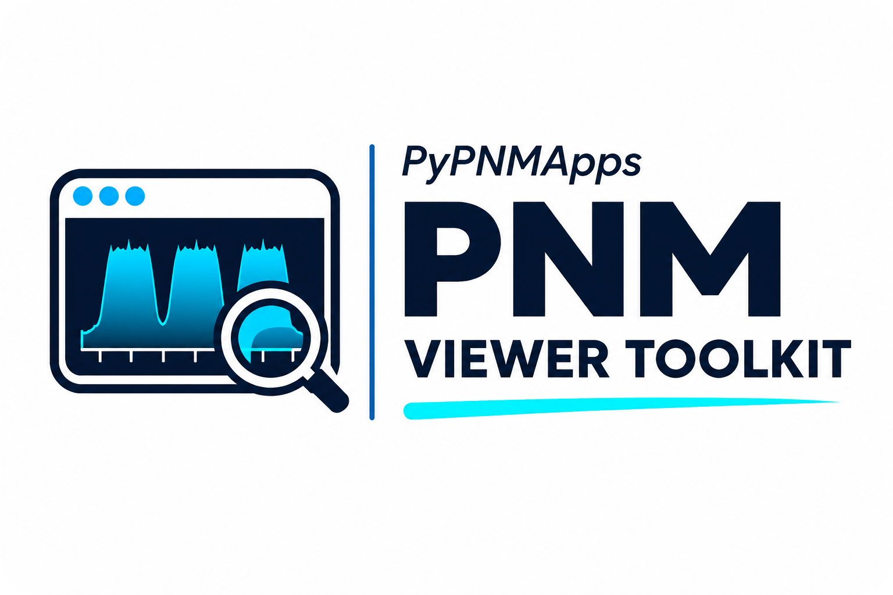
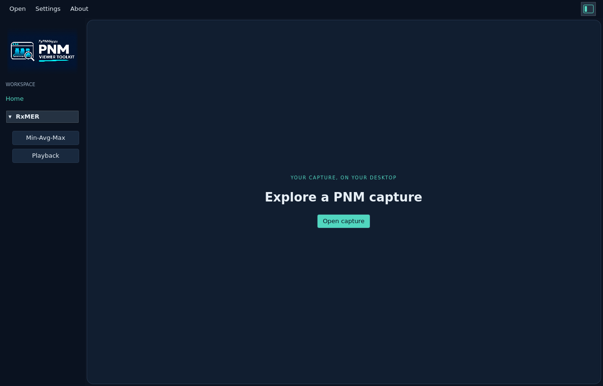

# PNM Viewer Toolkit — Under Development

  <picture>
    <source media="(prefers-color-scheme: dark)" srcset="docs/images/pnm-viewer-toolkit-logo-dark.svg">
    <source media="(prefers-color-scheme: light)" srcset="docs/images/pnm-viewer-toolkit-logo-light.svg">
    
  </picture>

Tag releases require the full native matrix: Ubuntu DEBs, Windows MSI, and
macOS Apple Silicon/Intel DMGs. [Installation by OS](docs/install/README.md).

An offline desktop viewer for DOCSIS PNM capture files. Open a capture, explore
its graph, and export decoded JSON. The native Qt interface uses a Rust backend.

<picture>
  <source media="(prefers-color-scheme: dark)" srcset="docs/ui/images/home/home-dark.png">
  <source media="(prefers-color-scheme: light)" srcset="docs/ui/images/home/home-light.png">
  
</picture>

## Start here

[Downloads](https://github.com/PyPNMApps/PNM-Viewer-Toolkit/releases) ·
[Installation](docs/install/README.md) ·
[Launch the viewer](docs/ui/README.md#launch) ·
[User guide](docs/ui/README.md) ·
[Screenshots and measurements](docs/ui/measurements.md)

The current viewer supports:

| Capture | Views |
| --- | --- |
| [RxMER](docs/ui/measurements/rxmer/README.md) | MER by frequency; [Modulation & Capacity](docs/ui/measurements/rxmer/README.md#modulation--capacity) |
| [Spectrum Analyzer](docs/ui/measurements/spectrum-analyzer/README.md) | Amplitude by frequency and calculated RBW |
| [DS Channel Estimation](docs/ui/measurements/channel-estimation/README.md) | Magnitude, group delay and I/Q dots and density |
| [US Pre-EQ (current)](docs/ui/measurements/upstream-pre-eq/README.md) | Coefficient magnitude, group delay, I/Q, and [Correction & Delta](docs/ui/measurements/upstream-pre-eq/README.md#correction--delta-from-the-left-gutter) |
| [US Pre-EQ (last update)](docs/ui/measurements/upstream-pre-eq-last/README.md) | RNG-RSP update magnitude, group delay and I/Q dots and density |
| [Histogram](docs/ui/measurements/histogram/README.md) | Hit counts by bin index |
| [FEC Summary](docs/ui/measurements/fec-summary/README.md) | Per-profile interval codewords over UTC time |
| [Constellation Display](docs/ui/measurements/constellation/README.md) | Soft/hard decisions and symbol boundaries |
| [Modulation Profile](docs/ui/measurements/modulation-profile/README.md) | Ideal Shannon minimum MER and bit loading by frequency |

Choose System, Dark or Light appearance. Drag across a graph to zoom and
double-click to reset; the I/Q dots and density view shows the full capture.

Tag builds automatically publish [native packages](docs/release/packaging.md)
after all required checks and uploaded-byte verification pass. Automatic tag
delivery currently covers Ubuntu 22.04 x64 only. Local
builds have been exercised on Ubuntu 22.04 x86_64; hosted results for the full
platform matrix remain pending.

## CLI and development

- [Build the standalone `pnm-decode` CLI](docs/install/source.md) · [CLI user guide](docs/cli/usage.md)
- [JSON examples for each PNM file type](docs/cli/usage.md#json-examples-by-file-type)
- [Supported formats and limits](docs/reference/formats.md)
- [Development setup](docs/install/development.md) · [Qt build and checks](docs/development/qt.md)
- [Rust APIs and examples](docs/development/rust.md)
- [Developer guide](docs/development/README.md) · [Version bumps and releases](docs/development/releasing.md)
- [All documentation](docs/README.md) · [Repository conventions](AGENTS.md)

## License

Core libraries and development tooling use Apache-2.0; desktop components use
GPL-3.0-only. See [LICENSE](LICENSE) and [NOTICE](NOTICE).
Built with guidance and example captures from **PyPNM**; third-party material
retains its original notices.
