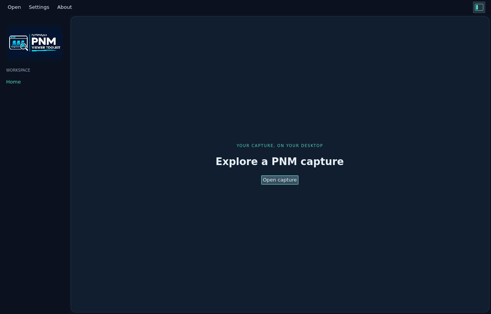

# PNM Viewer Toolkit user guide

[Project README](../../README.md) · [Measurement gallery](measurements.md)

[Bundled example captures](examples.md) are included in desktop installers and
are the initial location for Open. Standalone CLI archives do not include them.

The application is **under development**. This guide describes the native Qt
viewer in the current source tree. Screenshots use the repository's preserved
PyPNM example captures; appearance can vary with the operating system.

## Launch

For a packaged application, follow the release page or
[installation guide](../install/README.md), then launch PNM Viewer Toolkit from
the application menu (Ubuntu), Start (Windows), or Applications (macOS).

To run from source on the supported Linux development host, follow
[development setup](../install/development.md) and
[Qt prerequisites](../development/qt.md#linux-development), then run from the
repository root:

```bash
./scripts/setup-qt.sh
./scripts/qt-desktop.sh
```

Qt setup is needed once; subsequent launches use `./scripts/qt-desktop.sh`.
For VS Code Remote or SSH, see [display connection setup](../development/qt.md#no-display-connection).
The current UI has been exercised on Ubuntu 22.04 x86_64. Other native platforms
and packaged installation remain unverified.

## Starting screen

<picture>
  <source media="(prefers-color-scheme: dark)" srcset="../images/user-guide/home-dark.png">
  <source media="(prefers-color-scheme: light)" srcset="../images/user-guide/home-light.png">
  
</picture>

1. Drop one local capture file anywhere on the window, or choose **Open capture**,
   **Open** in the toolbar, or Ctrl+O (Cmd+O on macOS).
2. Select a local PNM file in the operating system's file picker. Detection uses
   the contents, not the filename extension.
3. Inspect the matching graph. See the [measurement gallery](measurements.md)
   for each supported view and its example file.
4. Use **⇩ Export JSON** to save the full decoded capture to a new destination.
5. Use **× Close capture** to return to Home.

Drops are available on Home and while viewing a capture. Drop one file at a
time; web links and multiple-file drops are ignored. The window highlights an
accepted drag in either theme. Dropping opens the capture in place and leaves
the source file unchanged. Drops pause during loading and while a dialog is open.
Invalid captures keep the current view.

Export includes the whole capture, even while zoomed. Existing destinations and
input files are never overwritten. Canceling a picker or opening an invalid file
keeps the current capture. Unsupported measurements can still be decoded with
[the CLI](../cli/usage.md) where [format support](../reference/formats.md) allows.

## Chart controls

- Drag across the plot to select and zoom into a frequency or bin range.
- Use the mouse wheel to zoom around the pointer; double-click to reset.
- Read the selected range at the bottom left. Histogram also shows its hit total.
- FEC Summary has a profile selector and Total/Corrected/Uncorrectable CW toggles.
  Its left axis shows total codewords and its right axis shows error codewords.
  Drag selects UTC time; window sums and the last interval update with the range.
- Modulation Profile has colored profile toggles and an **All** button for
  any combination of traces. Switch between ideal Shannon
  minimum MER and bit loading. These are derived from encoded assignments;
  the dB view is theoretical, not measured MER. Carrier-type buttons control
  data traces and labeled special-carrier lanes; hover markers for type details.
  Frequency zoom works as usual. The **Profile BW** chip opens a bandwidth
  grid. JSON includes per-profile `bandwidth_bps` and ideal capacity.
- Constellation Display overlays Soft decisions, Hard decisions and symbol
  decision boundaries, with independent toggles and drag/wheel zoom. See the
  [measurement guide](measurements.md#constellation-display).
- The I/Q density view always shows the full capture and does not use range zoom.
- For channel estimation and current/last-update upstream pre-EQ, choose **Magnitude**,
  **Group delay**, or **I/Q scatter**. The upstream plot describes correction
  coefficients, not a measured plant response. See [current pre-EQ](measurements.md#upstream-pre-eq-current)
  and [last update](measurements.md#upstream-pre-eq-last-update).
  Switching tabs resets the range.

Large datasets use bounded overviews calculated in Rust. Frequency plots preserve
extrema and missing-data gaps; histogram buckets sum counts. Zoom reveals finer
detail. Export retains full-resolution data.

## Settings and navigation

Choose **Settings → System… → Appearance** for **System**, **Dark**, or **Light**.
System follows the desktop appearance. This preference lasts for the current
session. Screenshots follow your documentation viewer's theme.

The panel button at the top right shows or hides the left navigation pane.
**About** shows the installed version, development status, project link and
software-update status. A background check runs once per normal launch;
it does not delay opening captures. Offline or failed checks leave the viewer
usable. **Check for updates** retries manually and reports the outcome.

When a newer published stable release exists, a compact green **Update** button
appears near the top-right navigation toggle. Click it to open About, see the
latest version and open **Release notes and downloads**. Draft releases and tags
without a published release are not updates. Until a release is published,
**No published release is available yet** is a normal result.
Partial releases appear on GitHub as prereleases for manual download. They
contain only platforms that passed validation and are excluded from the stable
update check; their associated workflow can still show failure for another OS.

Installed Ubuntu x64 builds offer **Install update and restart** when the
release has matching viewer/CLI DEBs with SHA-256 digests. Downloading and
verification run in Rust with progress and **Cancel download**. The OS asks for
administrator approval before both packages are installed together. Canceling
before installation leaves the installed version unchanged. Export work before
starting: after successful installation, the viewer automatically launches the
updated executable and closes the old window. An active capture/export operation
finishes first. If launching fails, the old window stays open and **Restart viewer**
allows a retry. Older versions that wait for this button still need that one click.
A failed apt operation can leave a partially updated package state; check both
package versions before retrying. Other OSes and source builds use release downloads.
On Windows, download the new MSI, quit the viewer, run the installer and relaunch;
**Check for updates** only checks versions. An older MSI is upgraded in place.
Older 0.1.6/0.1.7 builds require one manual upgrade to gain this installer.
**View releases** remains available when checks fail. The check
sends only a release lookup to this project's GitHub API, not capture contents
or device metadata. Native automated smoke tests skip the startup request.

Developer details belong in the [Qt guide](../development/qt.md).
