# Measurement gallery

[User guide](README.md) · [Project README](../../README.md)

These are actual Qt application screenshots using the preserved PyPNM fixtures
under `tests/fixtures/pypnm/tests/files/`. Each image follows your documentation
viewer's dark/light theme. Rust owns decoding and analysis; Qt renders the views.

## RxMER

RxMER in dB against frequency in MHz. Drag to investigate a frequency range; unavailable samples remain gaps.

Example: `rxmer.bin`.

<picture>
  <source media="(prefers-color-scheme: dark)" srcset="../images/user-guide/rxmer-dark.png">
  <source media="(prefers-color-scheme: light)" srcset="../images/user-guide/rxmer-light.png">
  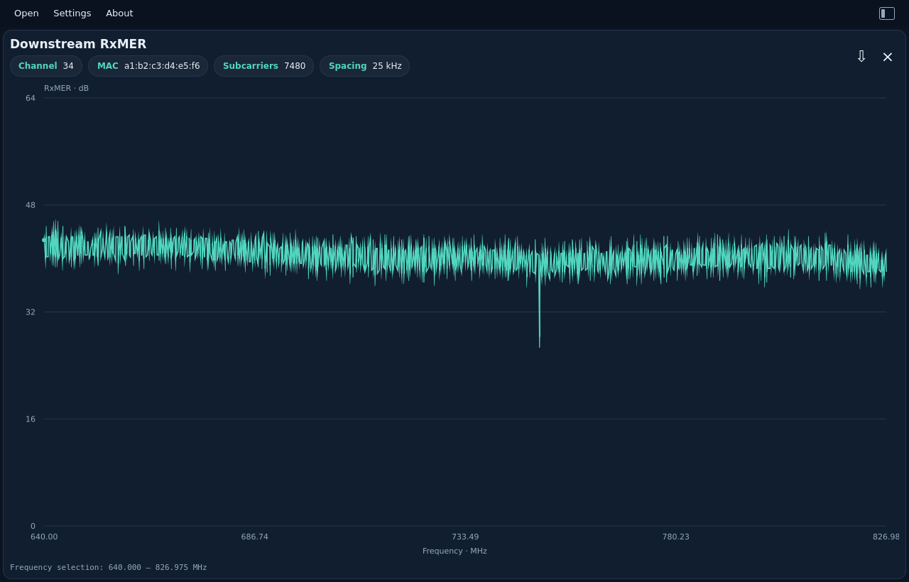
</picture>

## Spectrum Analyzer

Amplitude in dBmV against frequency in MHz. The RBW chip shows resolution bandwidth calculated in Rust from the capture fields.

Example: `spectrum_analyzer.bin`.

<picture>
  <source media="(prefers-color-scheme: dark)" srcset="../images/user-guide/spectrum-dark.png">
  <source media="(prefers-color-scheme: light)" srcset="../images/user-guide/spectrum-light.png">
  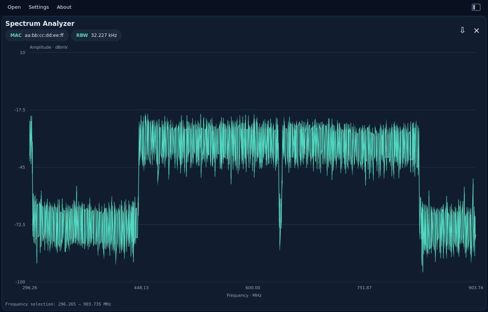
</picture>

## DS Channel Estimation — magnitude

Magnitude response in dB against frequency. The Channel and MAC chips identify the capture.

Example: `channel_estimation.bin`.

<picture>
  <source media="(prefers-color-scheme: dark)" srcset="../images/user-guide/channel-magnitude-dark.png">
  <source media="(prefers-color-scheme: light)" srcset="../images/user-guide/channel-magnitude-light.png">
  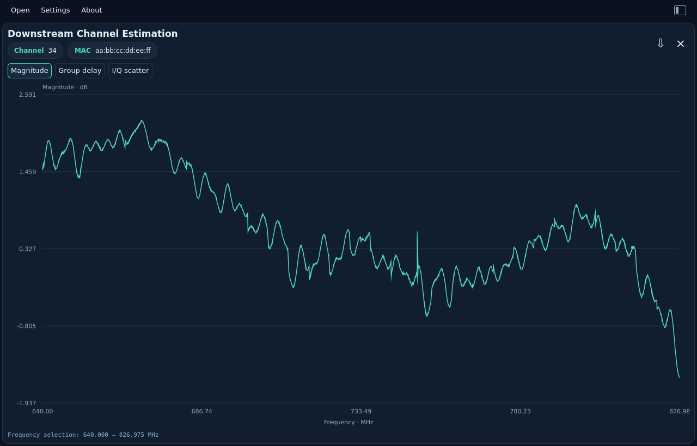
</picture>

## DS Channel Estimation — group delay

Group delay is displayed in microseconds. Desktop JSON exports `group_delay` pairs with `frequency_hz` and `delay_s` in seconds; unavailable values are `null`.

Example: `channel_estimation.bin`.

<picture>
  <source media="(prefers-color-scheme: dark)" srcset="../images/user-guide/channel-delay-dark.png">
  <source media="(prefers-color-scheme: light)" srcset="../images/user-guide/channel-delay-light.png">
  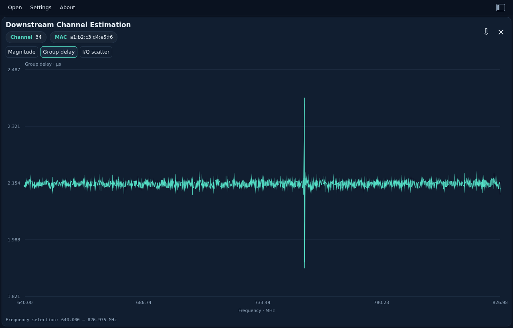
</picture>

## DS Channel Estimation — I/Q density

The full complex response on equal in-phase and quadrature axes. Color intensity represents sample count per cell; the footer gives valid and excluded totals. This view has no range zoom.

Example: `channel_estimation.bin`.

<picture>
  <source media="(prefers-color-scheme: dark)" srcset="../images/user-guide/channel-iq-dark.png">
  <source media="(prefers-color-scheme: light)" srcset="../images/user-guide/channel-iq-light.png">
  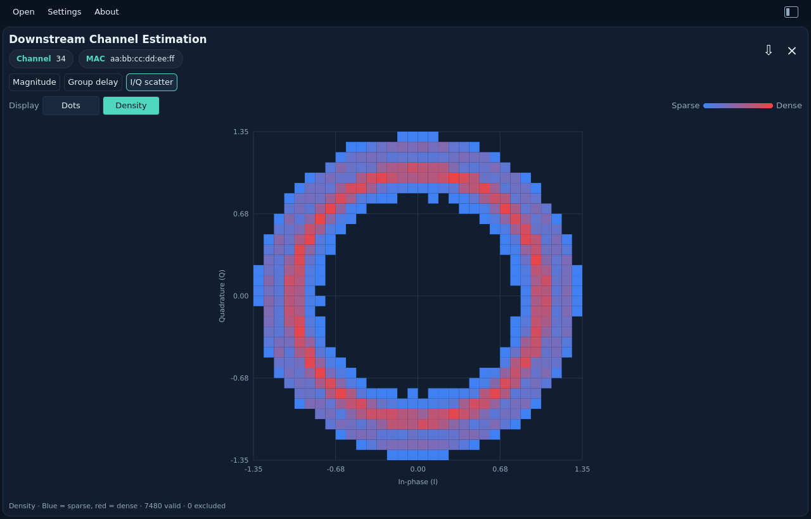
</picture>

## Histogram

Hit counts against zero-based bin index. Drag to inspect bins; the footer shows the selected range and exact hit total. Large ranges use explicitly labeled summed bins. JSON retains all raw hit counts, dwell counts and symmetry information.

Example: `histogram.bin`.

<picture>
  <source media="(prefers-color-scheme: dark)" srcset="../images/user-guide/histogram-dark.png">
  <source media="(prefers-color-scheme: light)" srcset="../images/user-guide/histogram-light.png">
  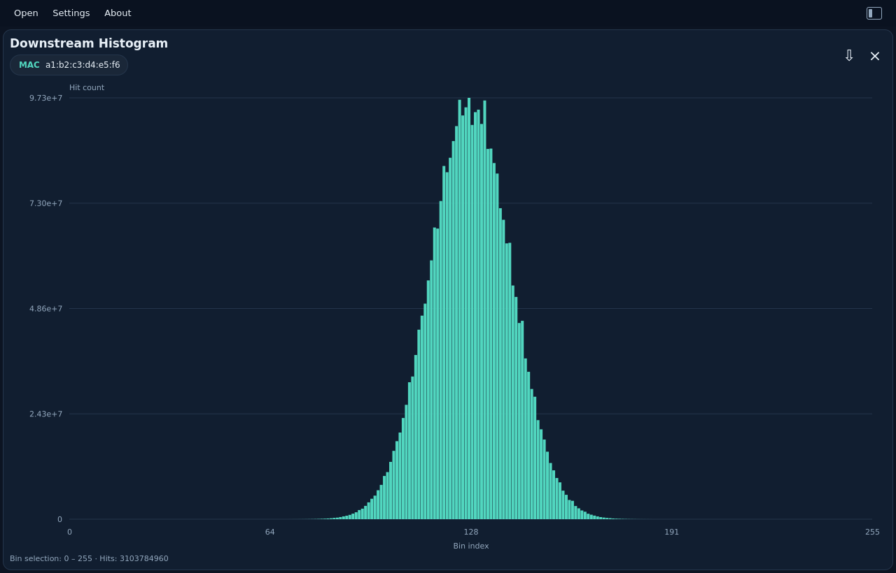
</picture>

## FEC Summary

Per-profile interval counts against UTC time, guided by the single-capture FEC
view in [PyPNM's unified WebUI](https://github.com/PyPNMApps/PyPNM-CMTS-WebUI/blob/25f40bda432f3c72df1e606bb229ffc5ba4eacf8/src/pw/features/operations/FecChannelChart.tsx).
Choose one profile and toggle Total, Corrected and Uncorrectable CW. The left
axis shows totals; the right shows corrected/uncorrectable counts. These are
counts per collection interval, not cumulative counters or calculated rates.

Drag to select a UTC range, use the mouse wheel to zoom, or double-click to
reset. Window sums and last-interval counts are calculated in Rust from every
selected record before chart decimation. Known one-second/one-minute gaps remain
breaks in the lines. Initial selection prefers profile 0; otherwise the first
profile is selected. Empty profiles are supported.

JSON export keeps all original profiles and records, regardless of the selected
profile, series toggles or zoom. No inferred error-rate fields are added.

Example: `fec_summary.bin` (five profiles, 600 intervals each).

<picture>
  <source media="(prefers-color-scheme: dark)" srcset="../images/user-guide/fec-summary-dark.png">
  <source media="(prefers-color-scheme: light)" srcset="../images/user-guide/fec-summary-light.png">
  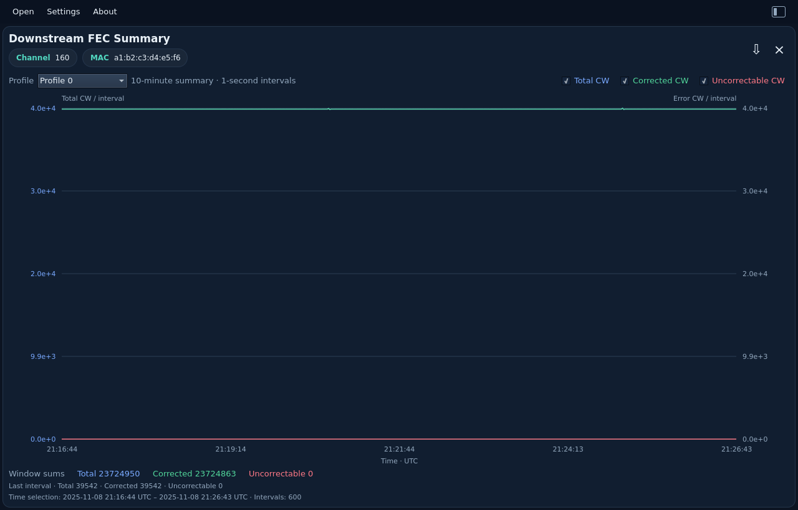
</picture>

## Modulation Profile

Choose **dB** or **Bit loading** in the left-aligned Y axis control. Toggle the
equal-sized **Profile** buttons to overlay any combination, or choose **All**.
The initial selection prefers profile 0; otherwise it uses the first profile.
Channel/MAC chips identify the capture. The **Profile BW** chip shows the
selected profile and its data-only bandwidth in Mbit/s, or the number of selected
profiles. Click it for a grid of every profile and its calculated bandwidth;
selected rows are highlighted. Profiles are alternative modulation choices, so
their rates are not summed. Rates cover the full profile and do not change with
zoom, the displayed metric or carrier visibility. Unavailable rates are labeled
explicitly. These ideal gross values exclude cyclic-prefix, FEC and other overhead.

Use the matching **Carriers** buttons to show or hide Data, Pilots, PLC,
Excluded, Zero-loaded, Reserved and Unknown assignments. Absent types are
disabled. Data, BPSK pilots and 16-QAM PLC data use the numeric axis; special
assignments also appear in labeled
lanes within the graph. Hover a lane marker for its carrier type, profile and
frequency. A grouped marker explicitly reports the number of carriers in its
frequency interval; it does not imply every frequency in that interval has that
type. Zooming reveals individual markers. Pilots show 1 bit / 0 dB ideal bound;
PLC data shows 4 bits / 11.76 dB ideal bound. Zero-loaded carriers retain zero
bit loading in JSON
and use their own graph lane.

The step plot supports drag zoom, mouse-wheel zoom and double-click reset.
Selected traces share a bounded extrema/gap overview and one frequency window;
zooming exposes detail. Changing profiles, carrier filters or metric resets the
range. Changing metric retains both selections. Deselect everything to leave
only the axes. Shorter profiles end without invented data.

Shannon values use `10 log10(2^bits − 1)`, an ideal capacity bound. They are
neither measured MER nor required DOCSIS operating thresholds. There is no
2 dB floor. Pilot transmit boosting does not change this ideal reference.
Excluded and reserved assignments stay gaps in both views. Zero-loaded carriers
appear in their own carrier lane. Skip schemes alternate main/skip
assignments starting with main, as defined by OSSI.

Frequency follows the current PyPNM compatibility convention:
`zero_frequency_hz + (first_active_subcarrier_index + ordinal) × spacing_hz`.
OSSI's generic assignment description also refers to a sequence starting at
subcarrier zero; this viewer does not assert those descriptions are equivalent.
JSON export preserves the original header and every compressed profile/scheme;
assignments include textual modulation, `bit_loading`, `carrier_type` and the
original numeric code. Constellation and `shannon_minimum_mer_db` are shared
with the CLI. PLC `preamble` separately describes its BPSK segment; the graph
shows its 16-QAM data segment. Neither PLC nor pilots add user-data capacity.
See the
[JSON field contract](../reference/formats.md#modulation-profile-json-assignments).
Each profile exports its data-only bit rate as `bandwidth_bps` next to the
profile ID, and Rust-derived ideal data capacity in `analysis`, including
data bandwidth and theoretical gross bit rate with explicit overhead exclusions.
See the [capacity contract](../reference/formats.md#per-profile-ideal-capacity-analysis).
Export retains compressed schemes and adds Rust-calculated ideal reference values.

Example: `modulation_profile.bin` (four profiles, 7,480 assignments each).

**Shannon minimum MER (ideal)**

<picture>
  <source media="(prefers-color-scheme: dark)" srcset="../images/user-guide/modulation-profile-dark.png">
  <source media="(prefers-color-scheme: light)" srcset="../images/user-guide/modulation-profile-light.png">
  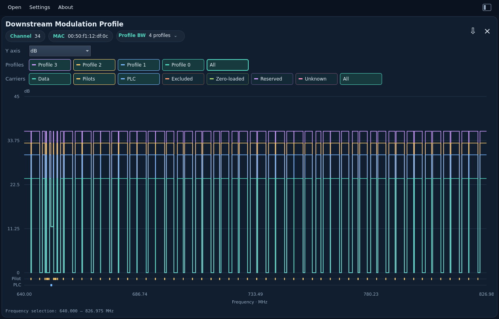
</picture>

**Bit loading**

<picture>
  <source media="(prefers-color-scheme: dark)" srcset="../images/user-guide/modulation-bits-dark.png">
  <source media="(prefers-color-scheme: light)" srcset="../images/user-guide/modulation-bits-light.png">
  
</picture>

**Profile bandwidth grid**

<picture>
  <source media="(prefers-color-scheme: dark)" srcset="../images/user-guide/profile-bandwidth-dark.png">
  <source media="(prefers-color-scheme: light)" srcset="../images/user-guide/profile-bandwidth-light.png">
  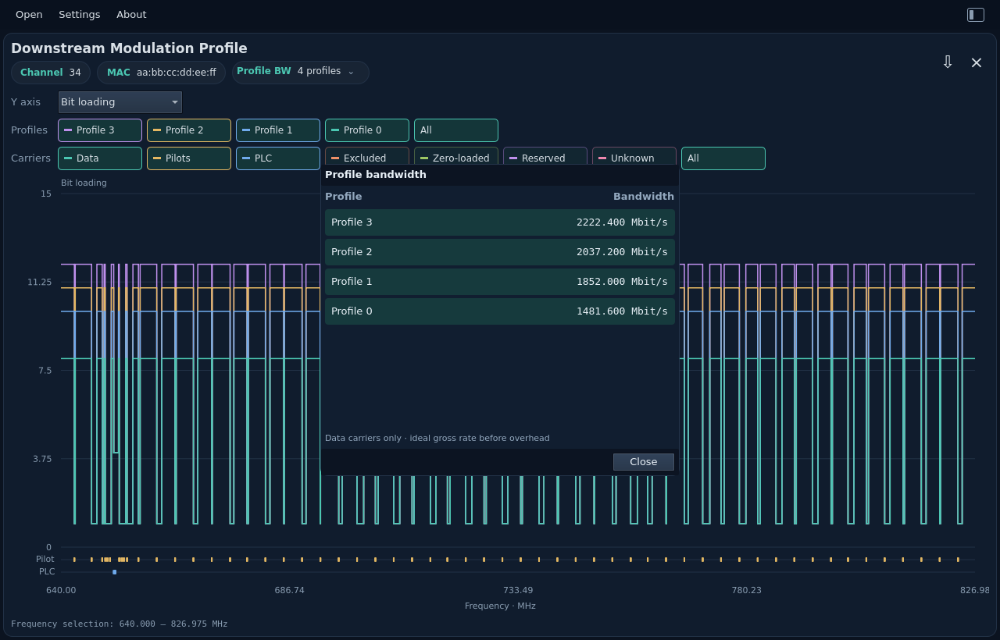
</picture>

## Constellation Display

Open or drop `const_display.bin`. Channel/MAC, QAM and sample chips identify
one captured constellation. The square chart overlays **Soft decisions**
(received I/Q samples) in teal and **Hard decisions** (ideal reference symbols)
as contrasting crosses. Toggle either layer independently. **Decision boundaries**
shows the nearest-reference regions for those symbols. All three controls have
the same size. Numeric X/Y scales and decorative axis grids are omitted.
I increases to the right and Q increases upward.

For square QAM, boundaries sit halfway between adjacent hard points, making
square interior cells. The cross-QAM tables require diagonal boundaries at their
missing corners. Outer decision regions extend indefinitely and are clipped by
the display window. This is ideal nearest-reference geometry, not decoded bits
or a reconstruction of the modem's internal decision logic.

Drag a rectangle to zoom into a region; the Rust viewer expands it to equal
I/Q scales. Mouse-wheel zoom follows the pointer. Double-click restores the
whole constellation. The display samples at most 512 points per layer. Zooming
requests fresh points from Rust and reveals all points once the selected region
fits the display budget. Boundaries use the complete reference table, even when
the hard points are sampled or hidden. Display sampling is not a density estimate.
Unknown modulation disables Hard decisions and Decision boundaries while
keeping the original soft samples viewable.

The CM has already normalized the soft samples. At build time Rust reads the
copied text resources, validates their energy, scales reference coordinates by
`1/sqrt(Es)`, and embeds static lookup arrays and boundary geometry in the binary.
No database or runtime table-file reads are used. See
[how QAM resources are compiled](../development/qam-resources.md).
Export retains every original I/Q sample, every hard-reference point and the
shared Rust boundary descriptors, regardless of zoom or layer visibility.

<picture>
  <source media="(prefers-color-scheme: dark)" srcset="../images/user-guide/constellation-dark.png">
  <source media="(prefers-color-scheme: light)" srcset="../images/user-guide/constellation-light.png">
  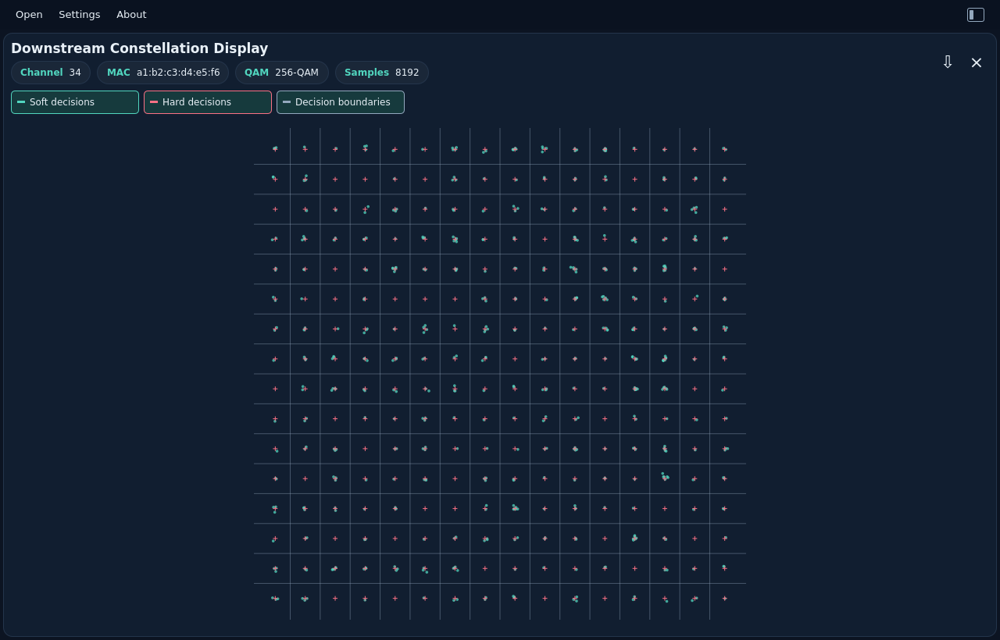
</picture>

## Upstream Pre-EQ (current)

Open or drop `us_pre_equalizer_coef.bin` (PNN6). The first upstream view uses the
current CM coefficients in s2.13 format. Channel, CM MAC and CMTS address chips
identify the capture. The CMTS field is the downstream channel MAC used for
MAPs/UCDs, as defined by OSSI. The **Current** chip distinguishes this capture
from the last-update format, which remains CLI-only for now.

Choose **Magnitude**, **Group delay**, or **I/Q scatter**. The layout follows
[PyPNM's single-capture pre-equalization view](https://github.com/PyPNMApps/PyPNM-CMTS-WebUI/blob/25f40bda432f3c72df1e606bb229ffc5ba4eacf8/src/pw/features/operations/SingleUsOfdmaPreEqualizationView.tsx),
with compact metadata and frequency-domain inspection:

- Magnitude is `20 log10(|I + jQ|)` in dB relative to unit amplitude. No extra
  normalization or smoothing is applied.
- Group delay is derived from the unwrapped coefficient phase and shown in µs.
  It describes the correction response, not measured cable propagation delay.
  Phase steps beyond π are ambiguous; no absolute delay is recovered.
- I/Q density includes every coefficient on equal I/Q axes; cell intensity
  represents sample count. This overview has no range zoom.

Drag to zoom a frequency range, use the mouse wheel around the pointer, and
double-click to reset. Switching tabs resets the range. Rust computes all
analysis and bounds the display to 1,024 points/cells while keeping full-resolution
exports. Zero coefficients stay in raw I/Q; undefined magnitude and delay become
null/gaps. Signed minimum coefficients are valid upstream samples, not the
excluded-carrier marker used by downstream channel estimates.

These are **pre-equalizer correction coefficients**, not a direct measured
channel response. This first view does not invert them into an estimated plant
response or infer echo distance. Current (PNN6) and last-update (PNN7) files are
separate measurements with different Q-formats; the viewer does not combine them.

Export JSON and `pnm-decode` share the same `pre_equalization_analysis` object,
including full-resolution frequencies, magnitude and frequency/delay pairs in
seconds. Original header, CMTS MAC and every I/Q sample are retained. See the
[JSON contract](../reference/formats.md#current-upstream-pre-equalization-analysis)
and [complete CLI example](../cli/examples/upstream-pre-eq.json).

**Magnitude**

<picture>
  <source media="(prefers-color-scheme: dark)" srcset="../images/user-guide/upstream-pre-eq-dark.png">
  <source media="(prefers-color-scheme: light)" srcset="../images/user-guide/upstream-pre-eq-light.png">
  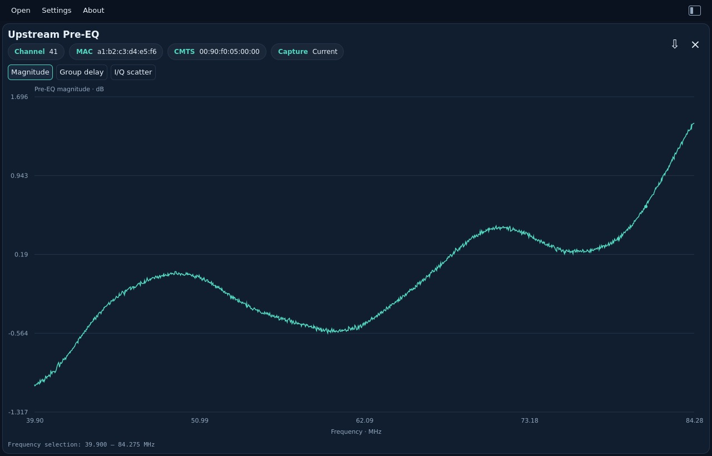
</picture>

**Group delay**

<picture>
  <source media="(prefers-color-scheme: dark)" srcset="../images/user-guide/upstream-pre-eq-delay-dark.png">
  <source media="(prefers-color-scheme: light)" srcset="../images/user-guide/upstream-pre-eq-delay-light.png">
  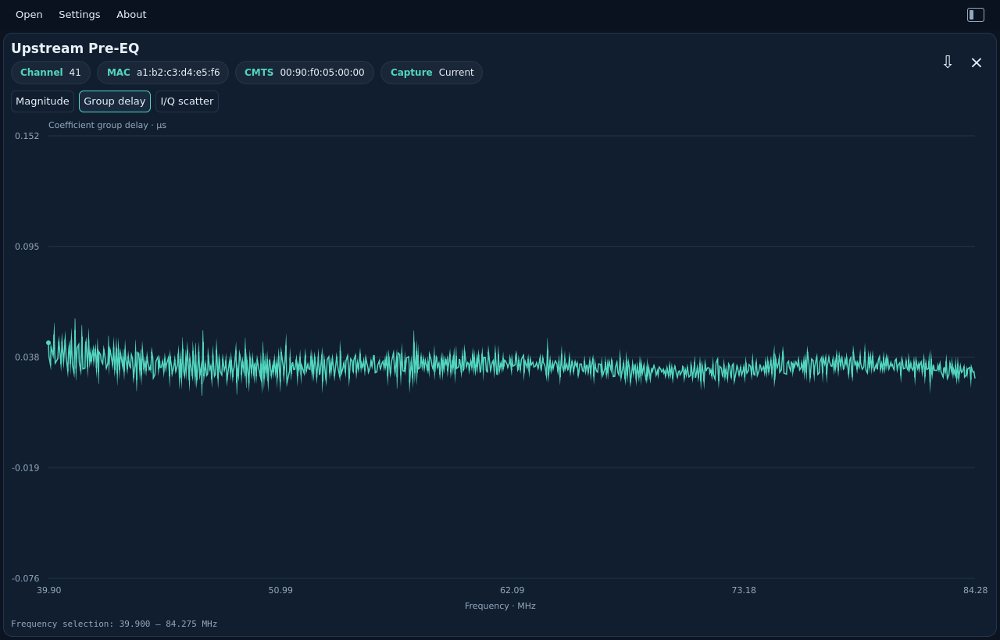
</picture>

**I/Q density**

<picture>
  <source media="(prefers-color-scheme: dark)" srcset="../images/user-guide/upstream-pre-eq-iq-dark.png">
  <source media="(prefers-color-scheme: light)" srcset="../images/user-guide/upstream-pre-eq-iq-light.png">
  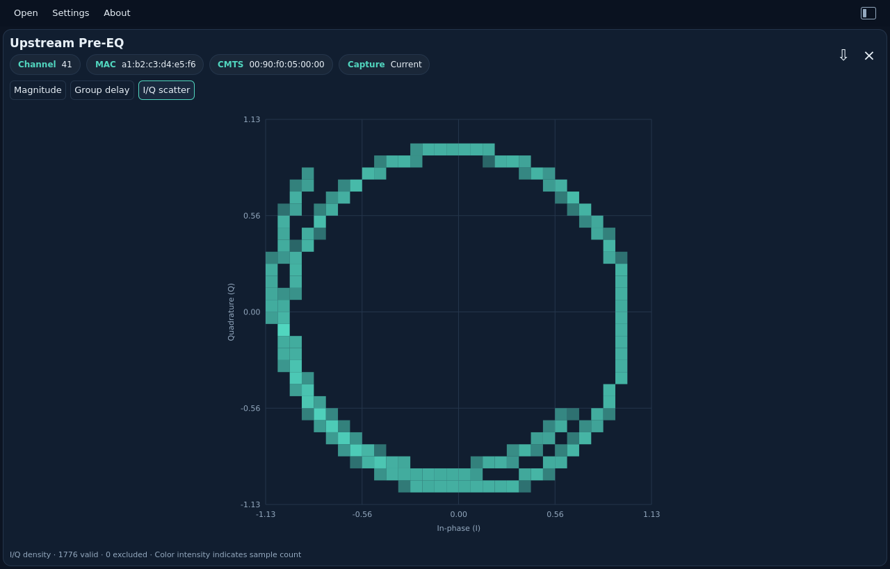
</picture>
