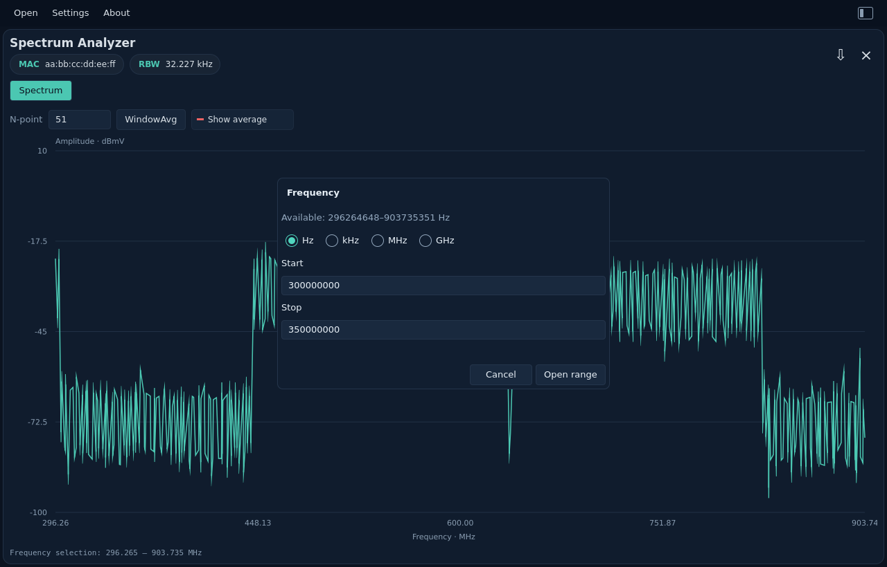
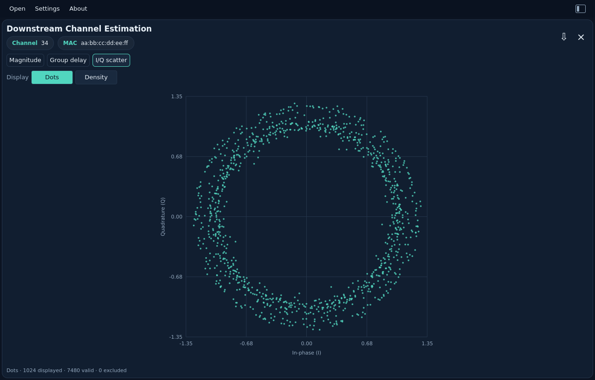
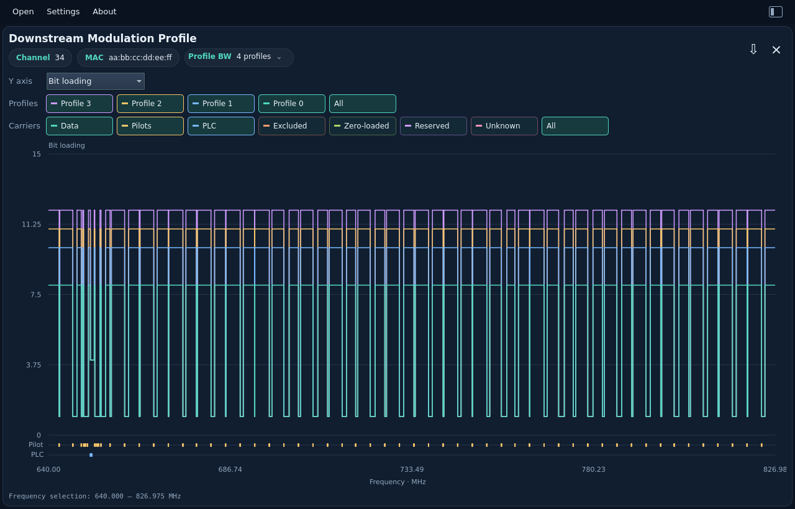
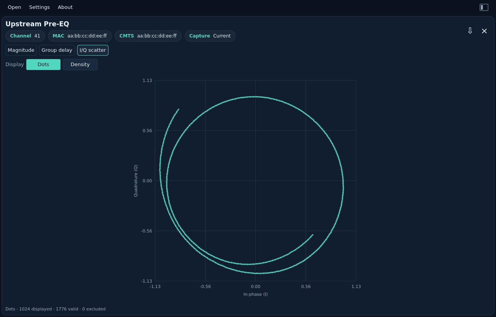
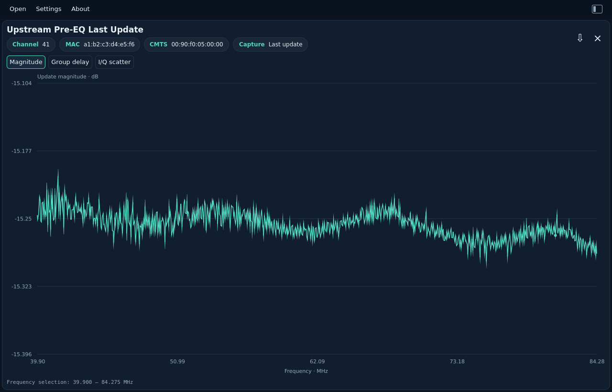
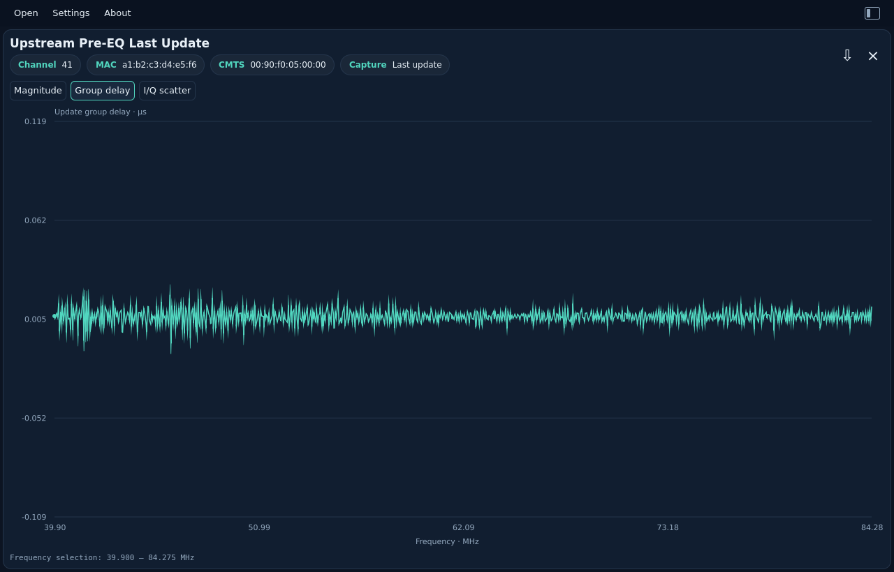
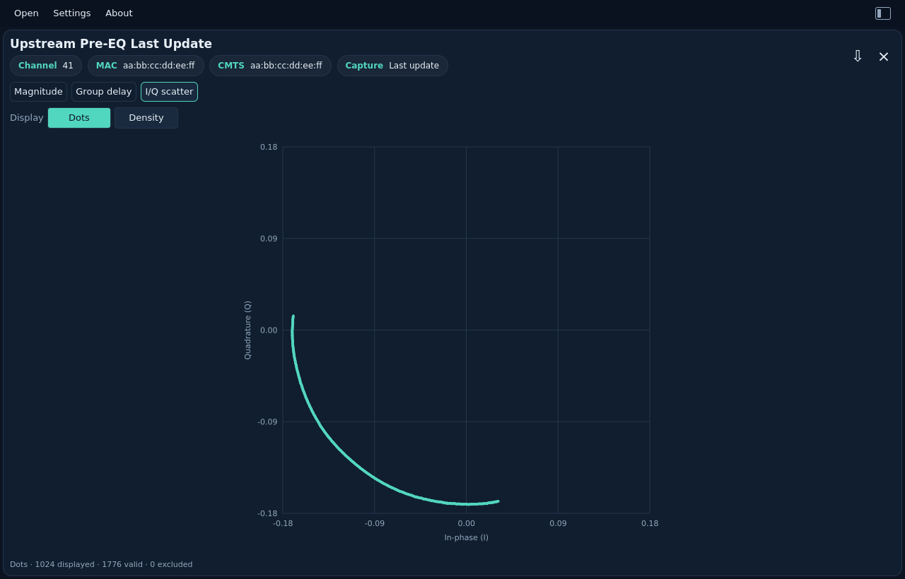
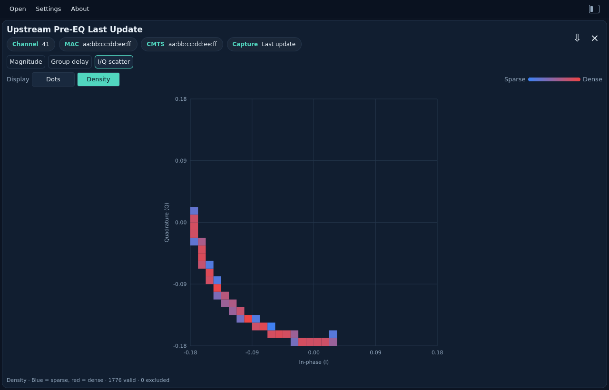

# Measurement gallery

[User guide](README.md) · [Project README](../../README.md)

These are actual Qt application screenshots using the preserved PyPNM fixtures
under `tests/fixtures/pypnm/tests/files/`. Each image follows your documentation
viewer's dark/light theme. Rust owns decoding and analysis; Qt renders the views.

## RxMER

RxMER in dB against frequency in MHz. Drag to investigate a frequency range; unavailable samples remain gaps.

Example: `rxmer.bin`.

<picture>
  <source media="(prefers-color-scheme: dark)" srcset="../images/user-guide/rxmer-dark.png">
  <source media="(prefers-color-scheme: light)" srcset="../images/user-guide/rxmer-light.png">
  
</picture>

## Spectrum Analyzer

Amplitude in dBmV against frequency in MHz. The RBW chip shows resolution
bandwidth calculated in Rust from the capture fields.

Enter a positive whole number in **N-point**, then press **WindowAvg** to add a
red averaged trace. **Show average** becomes enabled after calculation; press it
to hide or restore that line. Press WindowAvg again to apply a different N.
The default input is 101; allowed input is 1–2,147,483,647. N=1 reproduces the
original levels. The original trace remains teal.

Rust averages linear power: `10 × log10(mean(10^(dBmV / 10)))`. The window is
centered, with reflected samples at the capture ends. Even windows have one
more sample on the lower-frequency side. Windows can exceed the capture length.
Zoom uses the full-resolution source bins, so the same frequency has the same
average before and after zoom. This is smoothing across frequency; it does not
change acquisition RBW or calculate integrated channel power. JSON exports
contain the full original capture.

Right-click the spectrum for:

- **Calculate power…**: drag across the graph to highlight a band and calculate
  its integrated level in **dBmV**, shown to one decimal place. Larger labeled
  chips beside MAC and RBW show the integrated level, frequency range and
  bandwidth. They wrap onto another row when the window is narrow. Press Escape to cancel selection or clear its highlight.
  The calculation uses original bins and acquisition ENBW, even when an averaged
  trace is visible. It sums mean-square voltage; it does not average dB values.
- **Frequency…**: enter Start and Stop, select **Hz**, **kHz**, **MHz** or **GHz**,
  then press **Open range**. Invalid, reversed, out-of-capture or too-narrow graph
  ranges disable submission. The available capture bounds are shown in Hz.
  A range needs at least two original bin centers to create its graph.

The new range appears in a separate tab. Each tab has the same WindowAvg controls,
its own zoom, and its own averaging settings. Double-click resets to that tab's
range. Close a range with its **×**; the original Spectrum tab stays available.
Up to 16 tabs can be open, including the original. All share the same capture.
Opening another capture clears the tabs. Selection results are transient and do
not change the full original capture exported as JSON.

See [integration math and Rust architecture](../development/spectrum-power.md)
for the dBmV equation, ENBW correction and numerical assumptions.

Example: `spectrum_analyzer.bin`.

<picture>
  <source media="(prefers-color-scheme: dark)" srcset="../images/user-guide/spectrum-dark.png">
  <source media="(prefers-color-scheme: light)" srcset="../images/user-guide/spectrum-light.png">
  
</picture>

Frequency range dialog

<picture>
  <source media="(prefers-color-scheme: dark)" srcset="../images/user-guide/spectrum-frequency-dark.png">
  <source media="(prefers-color-scheme: light)" srcset="../images/user-guide/spectrum-frequency-light.png">
  
</picture>

## DS Channel Estimation — magnitude

Magnitude response in dB against frequency. The Channel and MAC chips identify the capture.

Example: `channel_estimation.bin`.

<picture>
  <source media="(prefers-color-scheme: dark)" srcset="../images/user-guide/channel-magnitude-dark.png">
  <source media="(prefers-color-scheme: light)" srcset="../images/user-guide/channel-magnitude-light.png">
  
</picture>

## DS Channel Estimation — group delay

Group delay is displayed in microseconds. Desktop JSON exports `group_delay` pairs with `frequency_hz` and `delay_s` in seconds; unavailable values are `null`.

Example: `channel_estimation.bin`.

<picture>
  <source media="(prefers-color-scheme: dark)" srcset="../images/user-guide/channel-delay-dark.png">
  <source media="(prefers-color-scheme: light)" srcset="../images/user-guide/channel-delay-light.png">
  
</picture>

## DS Channel Estimation — I/Q scatter

The I/Q view places the channel's complex coefficients on equal in-phase (I)
and quadrature (Q) axes. Choose **Dots** (the default) or **Density**.

### Why use this view?

Each coefficient has an amplitude and a phase. Its distance from the center
shows its amplitude; its angle around the center shows its phase. Seeing both
together can reveal groups, spread and unusual coefficients that are harder to
spot when looking at magnitude alone. Use the frequency plots to investigate
where a pattern occurs along the channel.

- **Dots** shows individual decoded coefficient positions. It is useful for
  spotting isolated points and the shape of the response. Up to 1,024 actual
  pairs are selected evenly in capture order, including the first and last
  valid pair. Larger captures are sampled for display; points are not grid-cell
  centers. Identical coordinates can overlap, and display sampling may omit
  isolated coefficients; Density includes all valid coefficients.
- **Density** includes every valid pair in a 32 × 32 grid. **Blue means fewer
  samples and red means more samples in that cell**, relative to the busiest
  cell in this capture. It makes overlapping clusters easier to see. Color
  does not mean distance from the origin, signal power, or good/bad quality.

These are **response coefficients, not received QAM symbols**. This view does
not measure constellation MER, locate a cable fault or diagnose its cause.
The same guidance applies to both upstream pre-EQ formats: those points describe
an equalizer correction or update, rather than the downstream channel response.
Do not compare their absolute amplitudes as if they were the same measurement.

Both modes cover the full capture without range zoom. The footer reports valid
and excluded totals; Dots also reports the number displayed. Exported JSON and
CLI output retain all original I/Q pairs, regardless of the display mode.

Example: `channel_estimation.bin`.

**Dots**

<picture>
  <source media="(prefers-color-scheme: dark)" srcset="../images/user-guide/channel-iq-dots-dark.png">
  <source media="(prefers-color-scheme: light)" srcset="../images/user-guide/channel-iq-dots-light.png">
  
</picture>

**Density**

<picture>
  <source media="(prefers-color-scheme: dark)" srcset="../images/user-guide/channel-iq-dark.png">
  <source media="(prefers-color-scheme: light)" srcset="../images/user-guide/channel-iq-light.png">
  
</picture>

## Histogram

Hit counts against zero-based bin index. Drag to inspect bins; the footer shows the selected range and exact hit total. Large ranges use explicitly labeled summed bins. JSON retains all raw hit counts, dwell counts and symmetry information.

Example: `histogram.bin`.

<picture>
  <source media="(prefers-color-scheme: dark)" srcset="../images/user-guide/histogram-dark.png">
  <source media="(prefers-color-scheme: light)" srcset="../images/user-guide/histogram-light.png">
  
</picture>

## FEC Summary

Per-profile interval counts against UTC time, guided by the single-capture FEC
view in [PyPNM's unified WebUI](https://github.com/PyPNMApps/PyPNM-CMTS-WebUI/blob/25f40bda432f3c72df1e606bb229ffc5ba4eacf8/src/pw/features/operations/FecChannelChart.tsx).
Choose one profile and toggle Total, Corrected and Uncorrectable CW. The left
axis shows totals; the right shows corrected/uncorrectable counts. These are
counts per collection interval, not cumulative counters or calculated rates.

Drag to select a UTC range, use the mouse wheel to zoom, or double-click to
reset. Window sums and last-interval counts are calculated in Rust from every
selected record before chart decimation. Known one-second/one-minute gaps remain
breaks in the lines. Initial selection prefers profile 0; otherwise the first
profile is selected. Empty profiles are supported.

JSON export keeps all original profiles and records, regardless of the selected
profile, series toggles or zoom. No inferred error-rate fields are added.

Example: `fec_summary.bin` (five profiles, 600 intervals each).

<picture>
  <source media="(prefers-color-scheme: dark)" srcset="../images/user-guide/fec-summary-dark.png">
  <source media="(prefers-color-scheme: light)" srcset="../images/user-guide/fec-summary-light.png">
  
</picture>

## Modulation Profile

Choose **dB** or **Bit loading** in the left-aligned Y axis control. Toggle the
equal-sized **Profile** buttons to overlay any combination, or choose **All**.
The initial selection prefers profile 0; otherwise it uses the first profile.
Channel/MAC chips identify the capture. The **Profile BW** chip shows the
selected profile and its data-only bandwidth in Mbit/s, or the number of selected
profiles. Click it for a grid of every profile and its calculated bandwidth;
selected rows are highlighted. Profiles are alternative modulation choices, so
their rates are not summed. Rates cover the full profile and do not change with
zoom, the displayed metric or carrier visibility. Unavailable rates are labeled
explicitly. These ideal gross values exclude cyclic-prefix, FEC and other overhead.

Use the matching **Carriers** buttons to show or hide Data, Pilots, PLC,
Excluded, Zero-loaded, Reserved and Unknown assignments. Absent types are
disabled. Data, BPSK pilots and 16-QAM PLC data use the numeric axis; special
assignments also appear in labeled
lanes within the graph. Hover a lane marker for its carrier type, profile and
frequency. A grouped marker explicitly reports the number of carriers in its
frequency interval; it does not imply every frequency in that interval has that
type. Zooming reveals individual markers. Pilots show 1 bit / 0 dB ideal bound;
PLC data shows 4 bits / 11.76 dB ideal bound. Zero-loaded carriers retain zero
bit loading in JSON
and use their own graph lane.

The step plot supports drag zoom, mouse-wheel zoom and double-click reset.
Selected traces share a bounded extrema/gap overview and one frequency window;
zooming exposes detail. Changing profiles, carrier filters or metric resets the
range. Changing metric retains both selections. Deselect everything to leave
only the axes. Shorter profiles end without invented data.

Shannon values use `10 log10(2^bits − 1)`, an ideal capacity bound. They are
neither measured MER nor required DOCSIS operating thresholds. There is no
2 dB floor. Pilot transmit boosting does not change this ideal reference.
Excluded and reserved assignments stay gaps in both views. Zero-loaded carriers
appear in their own carrier lane. Skip schemes alternate main/skip
assignments starting with main, as defined by OSSI.

Frequency follows the current PyPNM compatibility convention:
`zero_frequency_hz + (first_active_subcarrier_index + ordinal) × spacing_hz`.
OSSI's generic assignment description also refers to a sequence starting at
subcarrier zero; this viewer does not assert those descriptions are equivalent.
JSON export preserves the original header and every compressed profile/scheme;
assignments include textual modulation, `bit_loading`, `carrier_type` and the
original numeric code. Constellation and `shannon_minimum_mer_db` are shared
with the CLI. PLC `preamble` separately describes its BPSK segment; the graph
shows its 16-QAM data segment. Neither PLC nor pilots add user-data capacity.
See the
[JSON field contract](../reference/formats.md#modulation-profile-json-assignments).
Each profile exports its data-only bit rate as `bandwidth_bps` next to the
profile ID, and Rust-derived ideal data capacity in `analysis`, including
data bandwidth and theoretical gross bit rate with explicit overhead exclusions.
See the [capacity contract](../reference/formats.md#per-profile-ideal-capacity-analysis).
Export retains compressed schemes and adds Rust-calculated ideal reference values.

Example: `modulation_profile.bin` (four profiles, 7,480 assignments each).

**Shannon minimum MER (ideal)**

<picture>
  <source media="(prefers-color-scheme: dark)" srcset="../images/user-guide/modulation-profile-dark.png">
  <source media="(prefers-color-scheme: light)" srcset="../images/user-guide/modulation-profile-light.png">
  
</picture>

**Bit loading**

<picture>
  <source media="(prefers-color-scheme: dark)" srcset="../images/user-guide/modulation-bits-dark.png">
  <source media="(prefers-color-scheme: light)" srcset="../images/user-guide/modulation-bits-light.png">
  
</picture>

**Profile bandwidth grid**

<picture>
  <source media="(prefers-color-scheme: dark)" srcset="../images/user-guide/profile-bandwidth-dark.png">
  <source media="(prefers-color-scheme: light)" srcset="../images/user-guide/profile-bandwidth-light.png">
  
</picture>

## Constellation Display

Open or drop `const_display.bin`. Channel/MAC, QAM and sample chips identify
one captured constellation. The square chart overlays **Soft decisions**
(received I/Q samples) in teal and **Hard decisions** (ideal reference symbols)
as contrasting crosses. Toggle either layer independently. **Decision boundaries**
shows the nearest-reference regions for those symbols. All toggle buttons have
the same size. Numeric X/Y scales and decorative axis grids are omitted.
I increases to the right and Q increases upward.

The lower-right overlay shows **MER** in dB to one decimal place and **EVM**
as RMS percent to two decimal places. The **MER / EVM** button hides or shows
the overlay; it is shown by default. Both values come from the full capture,
independently of layer toggles, displayed point limits and zoom. The badge stays
in the plot corner when resized and does not intercept the mouse. Controls wrap
when needed to keep all buttons accessible in narrow windows.

`MER —` means no finite valid estimate is available. An exact perfect reference
shows `MER —` and `EVM 0.00 %`; its infinite MER is distinct in JSON. Missing or
invalid results show dashes. These remain decision-directed constellation
estimates, not OFDM per-subcarrier RxMER. Incorrect symbol decisions under severe
noise or distortion can make the results optimistic. The
[JSON contract](../reference/formats.md#estimated-constellation-mer) preserves
availability status, power sums and sample count.

For square QAM, boundaries sit halfway between adjacent hard points, making
square interior cells. The cross-QAM tables require diagonal boundaries at their
missing corners. Outer decision regions extend indefinitely and are clipped by
the display window. This is ideal nearest-reference geometry, not decoded bits
or a reconstruction of the modem's internal decision logic.

Drag a rectangle to zoom into a region; the Rust viewer expands it to equal
I/Q scales. Mouse-wheel zoom follows the pointer. Double-click restores the
whole constellation. The display samples at most 512 points per layer. Zooming
requests fresh points from Rust and reveals all points once the selected region
fits the display budget. Boundaries use the complete reference table, even when
the hard points are sampled or hidden. Display sampling is not a density estimate.
Unknown modulation disables Hard decisions and Decision boundaries while
keeping the original soft samples viewable.

The CM has already normalized the soft samples. At build time Rust reads the
copied text resources, validates their energy, scales reference coordinates by
`1/sqrt(Es)`, and embeds static lookup arrays and boundary geometry in the binary.
No database or runtime table-file reads are used. See
[how QAM resources are compiled](../development/qam-resources.md).
Export retains every original I/Q sample, every hard-reference point and the
shared Rust boundary descriptors, regardless of zoom or layer visibility.

<picture>
  <source media="(prefers-color-scheme: dark)" srcset="../images/user-guide/constellation-dark.png">
  <source media="(prefers-color-scheme: light)" srcset="../images/user-guide/constellation-light.png">
  
</picture>

## Upstream Pre-EQ (current)

Open or drop `us_pre_equalizer_coef.bin` (PNN6). The first upstream view uses the
current CM coefficients in s2.13 format. Channel, CM MAC and CMTS address chips
identify the capture. The CMTS field is the downstream channel MAC used for
MAPs/UCDs, as defined by OSSI. The **Current** chip distinguishes this capture
from the [last-update format](#upstream-pre-eq-last-update), which has its own view.

Choose **Magnitude**, **Group delay**, or **I/Q scatter**. The layout follows
[PyPNM's single-capture pre-equalization view](https://github.com/PyPNMApps/PyPNM-CMTS-WebUI/blob/25f40bda432f3c72df1e606bb229ffc5ba4eacf8/src/pw/features/operations/SingleUsOfdmaPreEqualizationView.tsx),
with compact metadata and frequency-domain inspection:

- Magnitude is `20 log10(|I + jQ|)` in dB relative to unit amplitude. No extra
  normalization or smoothing is applied.
- Group delay is derived from the unwrapped coefficient phase and shown in µs.
  It describes the correction response, not measured cable propagation delay.
  Phase steps beyond π are ambiguous; no absolute delay is recovered.
- I/Q scatter offers **Dots** and **Density** on equal axes. Dots shows up to
  1,024 original pairs; Density counts every valid pair, blue for sparse areas
  and red for dense clusters. See [why use this view](#why-use-this-view).
  This overview has no range zoom.

Drag to zoom a frequency range, use the mouse wheel around the pointer, and
double-click to reset. Switching tabs resets the range. Rust computes all
analysis and bounds the display to 1,024 points/cells while keeping full-resolution
exports. Zero coefficients stay in raw I/Q; undefined magnitude and delay become
null/gaps. Signed minimum coefficients are valid upstream samples, not the
excluded-carrier marker used by downstream channel estimates.

These are **pre-equalizer correction coefficients**, not a direct measured
channel response. This first view does not invert them into an estimated plant
response or infer echo distance. Current (PNN6) and last-update (PNN7) files are
separate measurements with different Q-formats; the viewer does not combine them.

Export JSON and `pnm-decode` share the same `pre_equalization_analysis` object,
including full-resolution frequencies, magnitude and frequency/delay pairs in
seconds. Original header, CMTS MAC and every I/Q sample are retained. See the
[JSON contract](../reference/formats.md#upstream-pre-equalization-analysis)
and [complete CLI example](../cli/examples/upstream-pre-eq.json).

**Magnitude**

<picture>
  <source media="(prefers-color-scheme: dark)" srcset="../images/user-guide/upstream-pre-eq-dark.png">
  <source media="(prefers-color-scheme: light)" srcset="../images/user-guide/upstream-pre-eq-light.png">
  
</picture>

**Group delay**

<picture>
  <source media="(prefers-color-scheme: dark)" srcset="../images/user-guide/upstream-pre-eq-delay-dark.png">
  <source media="(prefers-color-scheme: light)" srcset="../images/user-guide/upstream-pre-eq-delay-light.png">
  
</picture>

**I/Q scatter**

**Dots**

<picture>
  <source media="(prefers-color-scheme: dark)" srcset="../images/user-guide/upstream-pre-eq-iq-dots-dark.png">
  <source media="(prefers-color-scheme: light)" srcset="../images/user-guide/upstream-pre-eq-iq-dots-light.png">
  
</picture>

**Density**

<picture>
  <source media="(prefers-color-scheme: dark)" srcset="../images/user-guide/upstream-pre-eq-iq-dark.png">
  <source media="(prefers-color-scheme: light)" srcset="../images/user-guide/upstream-pre-eq-iq-light.png">
  
</picture>

## Upstream Pre-EQ (last update)

Open or drop `us_pre_equalizer_coef_last.bin` (PNN7). **Upstream Pre-EQ Last
Update** and the **Last update** chip distinguish this file from the current
coefficient set. Channel, CM MAC and CMTS MAC retain the same meanings.

This capture contains the complex coefficients sent in the last RNG-RSP that
contained a pre-EQ update, encoded in **s1.14**. It is a separate measurement
from the current s2.13 coefficient set. The file does not encode whether those
updates were applied, clipped or rejected; the viewer does not infer that status.
OSSI describes these CMTS equalizer updates as representing the residual channel
after pre-equalization. The charts show the captured update coefficients
as supplied, without combining them with a current capture or inverting them
into a measured plant response.

Choose **Magnitude**, **Group delay**, or **I/Q scatter**. Update magnitude is
in dB relative to unit amplitude. Update group delay is derived from unwrapped
coefficient phase and shown in µs; it is not absolute cable propagation delay.
The same drag/wheel zoom and double-click reset work on both frequency plots.
I/Q scatter offers **Dots** and **Density**, always covering the full capture.
Dots shows up to 1,024 original pairs; Density uses blue for sparse cells and red
for dense cells. See [why use this view](#why-use-this-view). Switching tabs resets the range.
All calculations, decimation and density aggregation run in shared Rust code.
Zero coefficients remain in raw I/Q and appear as gaps for undefined magnitude
and delay. Signed minimum pairs are valid coefficients.

Export and CLI now both include full-resolution `pre_equalization_analysis`
for last-update files, with `frequencies_hz`, `magnitude_db` and `group_delay`
pairs in seconds. Original metadata and s1.14 I/Q remain unchanged. Zoom never
reduces exported data. See the [JSON contract](../reference/formats.md#upstream-pre-equalization-analysis)
and [complete last-update example](../cli/examples/upstream-pre-eq-last.json).

**Magnitude**

<picture>
  <source media="(prefers-color-scheme: dark)" srcset="../images/user-guide/upstream-pre-eq-last-dark.png">
  <source media="(prefers-color-scheme: light)" srcset="../images/user-guide/upstream-pre-eq-last-light.png">
  
</picture>

**Group delay**

<picture>
  <source media="(prefers-color-scheme: dark)" srcset="../images/user-guide/upstream-pre-eq-last-delay-dark.png">
  <source media="(prefers-color-scheme: light)" srcset="../images/user-guide/upstream-pre-eq-last-delay-light.png">
  
</picture>

**I/Q scatter**

**Dots**

<picture>
  <source media="(prefers-color-scheme: dark)" srcset="../images/user-guide/upstream-pre-eq-last-iq-dots-dark.png">
  <source media="(prefers-color-scheme: light)" srcset="../images/user-guide/upstream-pre-eq-last-iq-dots-light.png">
  
</picture>

**Density**

<picture>
  <source media="(prefers-color-scheme: dark)" srcset="../images/user-guide/upstream-pre-eq-last-iq-dark.png">
  <source media="(prefers-color-scheme: light)" srcset="../images/user-guide/upstream-pre-eq-last-iq-light.png">
  
</picture>
