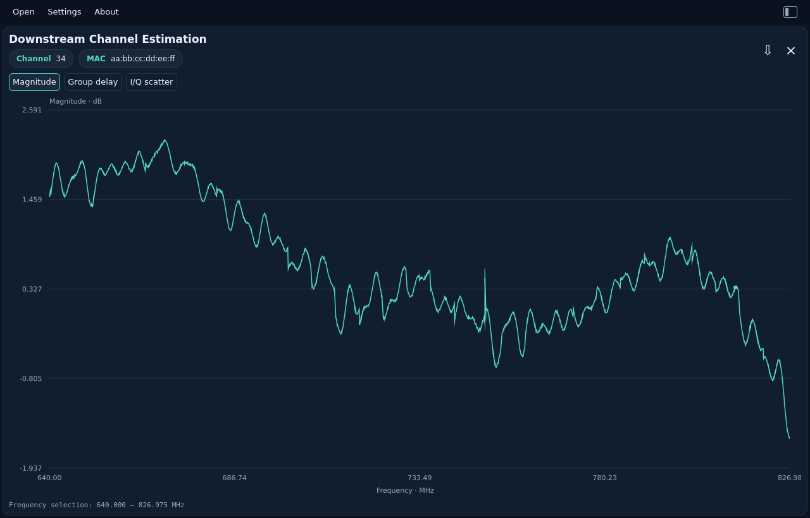
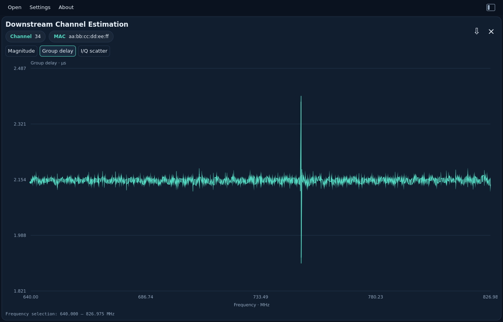
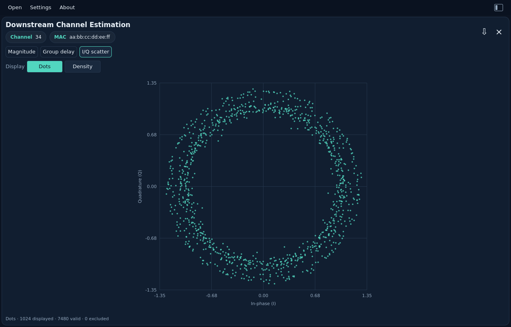
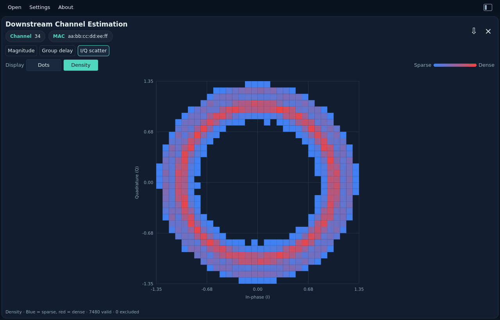

# DS Channel Estimation

[All measurements](../../measurements.md) · [User guide](../../README.md) · [Project README](../../../../README.md)

## Magnitude

Magnitude response in dB against frequency. The Channel and MAC chips identify the capture.

Example: `channel_estimation.bin`.

<picture>
  <source media="(prefers-color-scheme: dark)" srcset="images/channel-magnitude-dark.png">
  <source media="(prefers-color-scheme: light)" srcset="images/channel-magnitude-light.png">
  
</picture>

## Group delay

Group delay is displayed in microseconds. Desktop JSON exports `group_delay` pairs with `frequency_hz` and `delay_s` in seconds; unavailable values are `null`.

Example: `channel_estimation.bin`.

<picture>
  <source media="(prefers-color-scheme: dark)" srcset="images/channel-delay-dark.png">
  <source media="(prefers-color-scheme: light)" srcset="images/channel-delay-light.png">
  
</picture>

## I/Q scatter

The I/Q view places the channel's complex coefficients on equal in-phase (I)
and quadrature (Q) axes. Choose **Dots** (the default) or **Density**.

### Why use this view?

Each coefficient has an amplitude and a phase. Its distance from the center
shows its amplitude; its angle around the center shows its phase. Seeing both
together can reveal groups, spread and unusual coefficients that are harder to
spot when looking at magnitude alone. Use the frequency plots to investigate
where a pattern occurs along the channel.

- **Dots** shows individual decoded coefficient positions. It is useful for
  spotting isolated points and the shape of the response. Up to 1,024 actual
  pairs are selected evenly in capture order, including the first and last
  valid pair. Larger captures are sampled for display; points are not grid-cell
  centers. Identical coordinates can overlap, and display sampling may omit
  isolated coefficients; Density includes all valid coefficients.
- **Density** includes every valid pair in a 32 × 32 grid. **Blue means fewer
  samples and red means more samples in that cell**, relative to the busiest
  cell in this capture. It makes overlapping clusters easier to see. Color
  does not mean distance from the origin, signal power, or good/bad quality.

These are **response coefficients, not received QAM symbols**. This view does
not measure constellation MER, locate a cable fault or diagnose its cause.
The same guidance applies to both upstream pre-EQ formats: those points describe
an equalizer correction or update, rather than the downstream channel response.
Do not compare their absolute amplitudes as if they were the same measurement.

Both modes cover the full capture without range zoom. The footer reports valid
and excluded totals; Dots also reports the number displayed. Exported JSON and
CLI output retain all original I/Q pairs, regardless of the display mode.

Example: `channel_estimation.bin`.

**Dots**

<picture>
  <source media="(prefers-color-scheme: dark)" srcset="images/channel-iq-dots-dark.png">
  <source media="(prefers-color-scheme: light)" srcset="images/channel-iq-dots-light.png">
  
</picture>

**Density**

<picture>
  <source media="(prefers-color-scheme: dark)" srcset="images/channel-iq-dark.png">
  <source media="(prefers-color-scheme: light)" srcset="images/channel-iq-light.png">
  
</picture>

