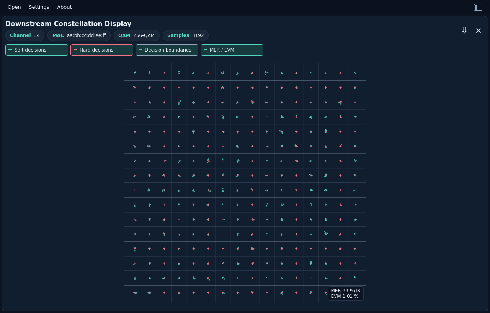

# Constellation Display

[All measurements](../../measurements.md) · [User guide](../../README.md) · [Project README](../../../../README.md)

Open or drop `const_display.bin`. Channel/MAC, QAM and sample chips identify
one captured constellation. The square chart overlays **Soft decisions**
(received I/Q samples) in teal and **Hard decisions** (ideal reference symbols)
as contrasting crosses. Toggle either layer independently. **Decision boundaries**
shows the nearest-reference regions for those symbols. All toggle buttons have
the same size. Numeric X/Y scales and decorative axis grids are omitted.
I increases to the right and Q increases upward.

The lower-right overlay shows **MER** in dB to one decimal place and **EVM**
as RMS percent to two decimal places. The **MER / EVM** button hides or shows
the overlay; it is shown by default. Both values come from the full capture,
independently of layer toggles, displayed point limits and zoom. The badge stays
in the plot corner when resized and does not intercept the mouse. Controls wrap
when needed to keep all buttons accessible in narrow windows.

`MER —` means no finite valid estimate is available. An exact perfect reference
shows `MER —` and `EVM 0.00 %`; its infinite MER is distinct in JSON. Missing or
invalid results show dashes. These remain decision-directed constellation
estimates, not OFDM per-subcarrier RxMER. Incorrect symbol decisions under severe
noise or distortion can make the results optimistic. The
[JSON contract](../../../reference/formats.md#estimated-constellation-mer) preserves
availability status, power sums and sample count.

For square QAM, boundaries sit halfway between adjacent hard points, making
square interior cells. The cross-QAM tables require diagonal boundaries at their
missing corners. Outer decision regions extend indefinitely and are clipped by
the display window. This is ideal nearest-reference geometry, not decoded bits
or a reconstruction of the modem's internal decision logic.

Drag a rectangle to zoom into a region; the Rust viewer expands it to equal
I/Q scales. Mouse-wheel zoom follows the pointer. Double-click restores the
whole constellation. The display samples at most 512 points per layer. Zooming
requests fresh points from Rust and reveals all points once the selected region
fits the display budget. Boundaries use the complete reference table, even when
the hard points are sampled or hidden. Display sampling is not a density estimate.
Unknown modulation disables Hard decisions and Decision boundaries while
keeping the original soft samples viewable.

The CM has already normalized the soft samples. At build time Rust reads the
copied text resources, validates their energy, scales reference coordinates by
`1/sqrt(Es)`, and embeds static lookup arrays and boundary geometry in the binary.
No database or runtime table-file reads are used. See
[how QAM resources are compiled](../../../development/qam-resources.md).
Export retains every original I/Q sample, every hard-reference point and the
shared Rust boundary descriptors, regardless of zoom or layer visibility.

<picture>
  <source media="(prefers-color-scheme: dark)" srcset="images/constellation-dark.png">
  <source media="(prefers-color-scheme: light)" srcset="images/constellation-light.png">
  
</picture>

