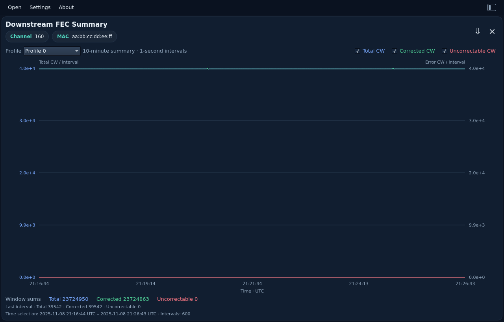

# FEC Summary

[All measurements](../../measurements.md) · [User guide](../../README.md) · [Project README](../../../../README.md)

Per-profile interval counts against UTC time, guided by the single-capture FEC
view in [PyPNM's unified WebUI](https://github.com/PyPNMApps/PyPNM-CMTS-WebUI/blob/25f40bda432f3c72df1e606bb229ffc5ba4eacf8/src/pw/features/operations/FecChannelChart.tsx).
Choose one profile and toggle Total, Corrected and Uncorrectable CW. The left
axis shows totals; the right shows corrected/uncorrectable counts. These are
counts per collection interval, not cumulative counters or calculated rates.

Drag to select a UTC range, use the mouse wheel to zoom, or double-click to
reset. Window sums and last-interval counts are calculated in Rust from every
selected record before chart decimation. Known one-second/one-minute gaps remain
breaks in the lines. Initial selection prefers profile 0; otherwise the first
profile is selected. Empty profiles are supported.

JSON export keeps all original profiles and records, regardless of the selected
profile, series toggles or zoom. No inferred error-rate fields are added.

Example: `fec_summary.bin` (five profiles, 600 intervals each).

<picture>
  <source media="(prefers-color-scheme: dark)" srcset="images/fec-summary-dark.png">
  <source media="(prefers-color-scheme: light)" srcset="images/fec-summary-light.png">
  
</picture>

