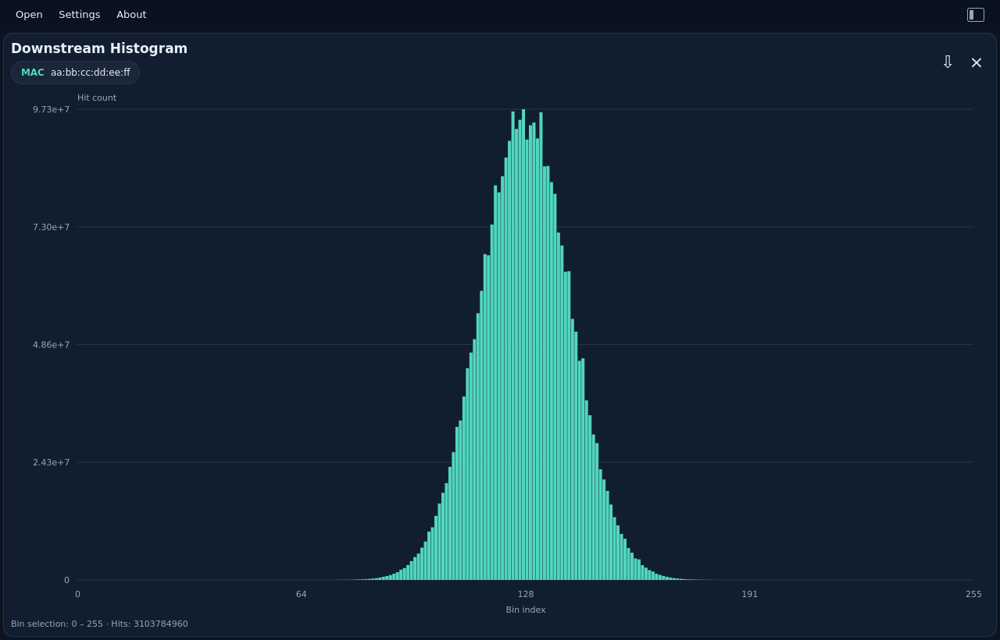

# Histogram

[All measurements](../../measurements.md) · [User guide](../../README.md) · [Project README](../../../../README.md)

Hit counts against zero-based bin index. Drag to inspect bins; the footer shows the selected range and exact hit total. Large ranges use explicitly labeled summed bins. JSON retains all raw hit counts, dwell counts and symmetry information.

Example: `histogram.bin`.

<picture>
  <source media="(prefers-color-scheme: dark)" srcset="images/histogram-dark.png">
  <source media="(prefers-color-scheme: light)" srcset="images/histogram-light.png">
  
</picture>

