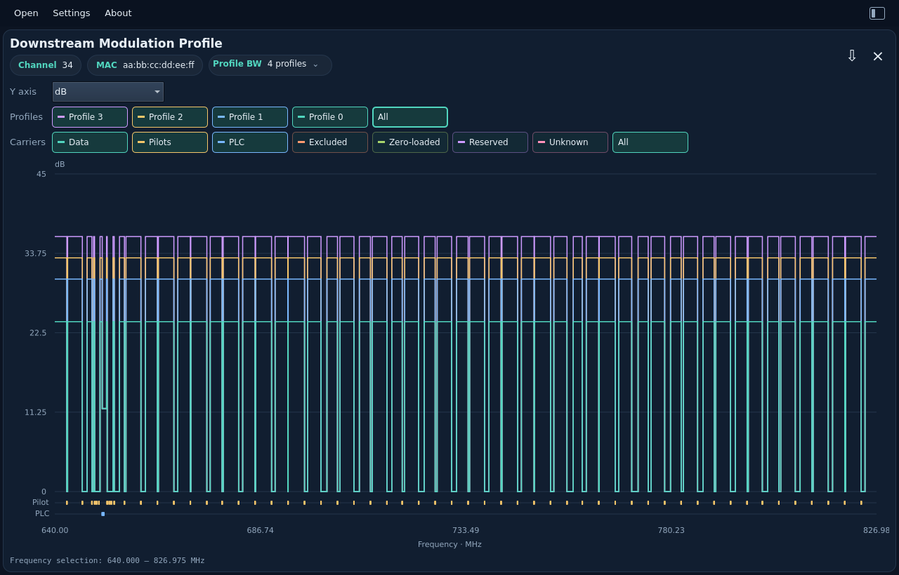
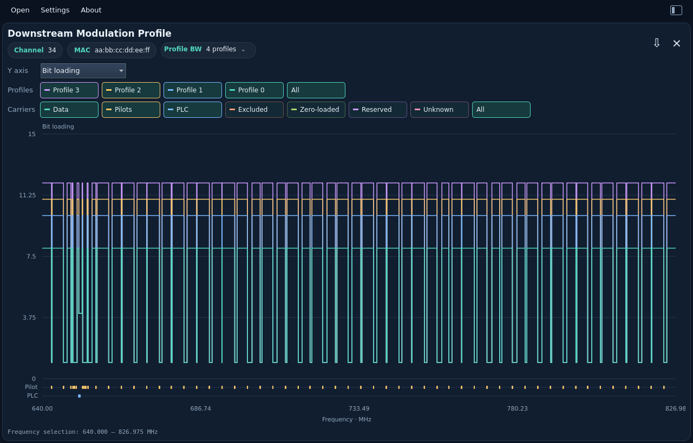
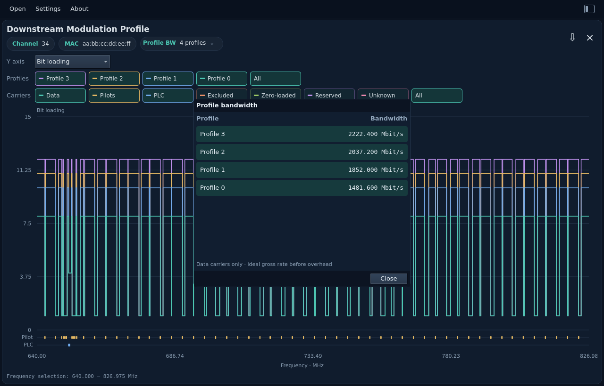

# Modulation Profile

[All measurements](../../measurements.md) · [User guide](../../README.md) · [Project README](../../../../README.md)

Choose **dB** or **Bit loading** in the left-aligned Y axis control. Toggle the
equal-sized **Profile** buttons to overlay any combination, or choose **All**.
The initial selection prefers profile 0; otherwise it uses the first profile.
Channel/MAC chips identify the capture. The **Profile BW** chip shows the
selected profile and its data-only bandwidth in Mbit/s, or the number of selected
profiles. Click it for a grid of every profile and its calculated bandwidth;
selected rows are highlighted. Profiles are alternative modulation choices, so
their rates are not summed. Rates cover the full profile and do not change with
zoom, the displayed metric or carrier visibility. Unavailable rates are labeled
explicitly. These ideal gross values exclude cyclic-prefix, FEC and other overhead.

Use the matching **Carriers** buttons to show or hide Data, Pilots, PLC,
Excluded, Zero-loaded, Reserved and Unknown assignments. Absent types are
disabled. Data, BPSK pilots and 16-QAM PLC data use the numeric axis; special
assignments also appear in labeled
lanes within the graph. Hover a lane marker for its carrier type, profile and
frequency. A grouped marker explicitly reports the number of carriers in its
frequency interval; it does not imply every frequency in that interval has that
type. Zooming reveals individual markers. Pilots show 1 bit / 0 dB ideal bound;
PLC data shows 4 bits / 11.76 dB ideal bound. Zero-loaded carriers retain zero
bit loading in JSON
and use their own graph lane.

The step plot supports drag zoom, mouse-wheel zoom and double-click reset.
Selected traces share a bounded extrema/gap overview and one frequency window;
zooming exposes detail. Changing profiles, carrier filters or metric resets the
range. Changing metric retains both selections. Deselect everything to leave
only the axes. Shorter profiles end without invented data.

Shannon values use `10 log10(2^bits − 1)`, an ideal capacity bound. They are
neither measured MER nor required DOCSIS operating thresholds. There is no
2 dB floor. Pilot transmit boosting does not change this ideal reference.
Excluded and reserved assignments stay gaps in both views. Zero-loaded carriers
appear in their own carrier lane. Skip schemes alternate main/skip
assignments starting with main, as defined by OSSI.

Frequency follows the current PyPNM compatibility convention:
`zero_frequency_hz + (first_active_subcarrier_index + ordinal) × spacing_hz`.
OSSI's generic assignment description also refers to a sequence starting at
subcarrier zero; this viewer does not assert those descriptions are equivalent.
JSON export preserves the original header and every compressed profile/scheme;
assignments include textual modulation, `bit_loading`, `carrier_type` and the
original numeric code. Constellation and `shannon_minimum_mer_db` are shared
with the CLI. PLC `preamble` separately describes its BPSK segment; the graph
shows its 16-QAM data segment. Neither PLC nor pilots add user-data capacity.
See the
[JSON field contract](../../../reference/formats.md#modulation-profile-json-assignments).
Each profile exports its data-only bit rate as `bandwidth_bps` next to the
profile ID, and Rust-derived ideal data capacity in `analysis`, including
data bandwidth and theoretical gross bit rate with explicit overhead exclusions.
See the [capacity contract](../../../reference/formats.md#per-profile-ideal-capacity-analysis).
Export retains compressed schemes and adds Rust-calculated ideal reference values.

Example: `modulation_profile.bin` (four profiles, 7,480 assignments each).

**Shannon minimum MER (ideal)**

<picture>
  <source media="(prefers-color-scheme: dark)" srcset="images/modulation-profile-dark.png">
  <source media="(prefers-color-scheme: light)" srcset="images/modulation-profile-light.png">
  
</picture>

**Bit loading**

<picture>
  <source media="(prefers-color-scheme: dark)" srcset="images/modulation-bits-dark.png">
  <source media="(prefers-color-scheme: light)" srcset="images/modulation-bits-light.png">
  
</picture>

**Profile bandwidth grid**

<picture>
  <source media="(prefers-color-scheme: dark)" srcset="images/profile-bandwidth-dark.png">
  <source media="(prefers-color-scheme: light)" srcset="images/profile-bandwidth-light.png">
  
</picture>

