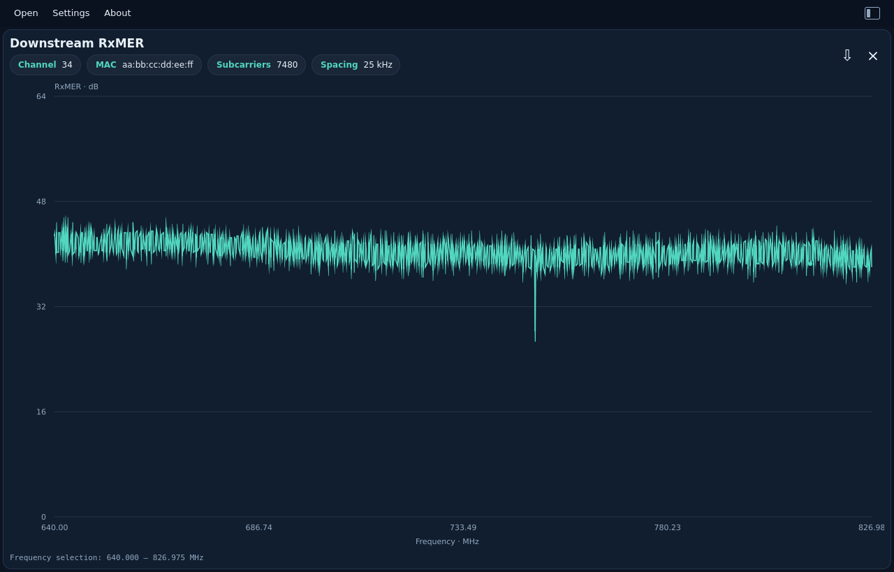
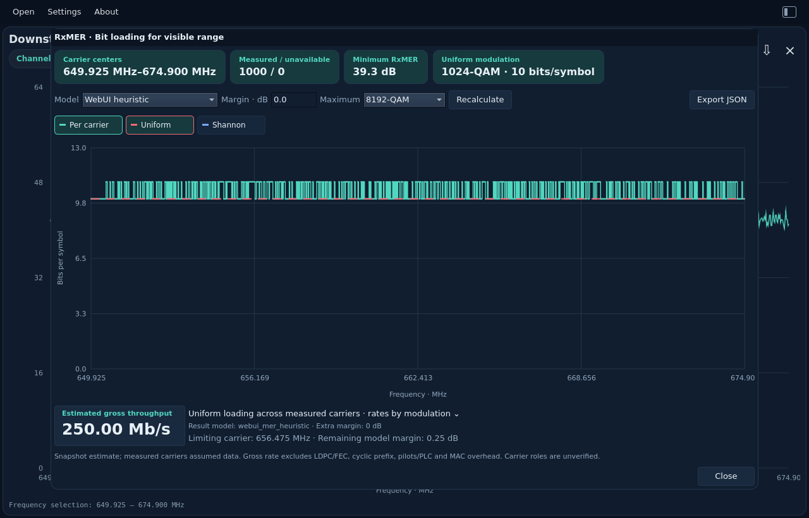
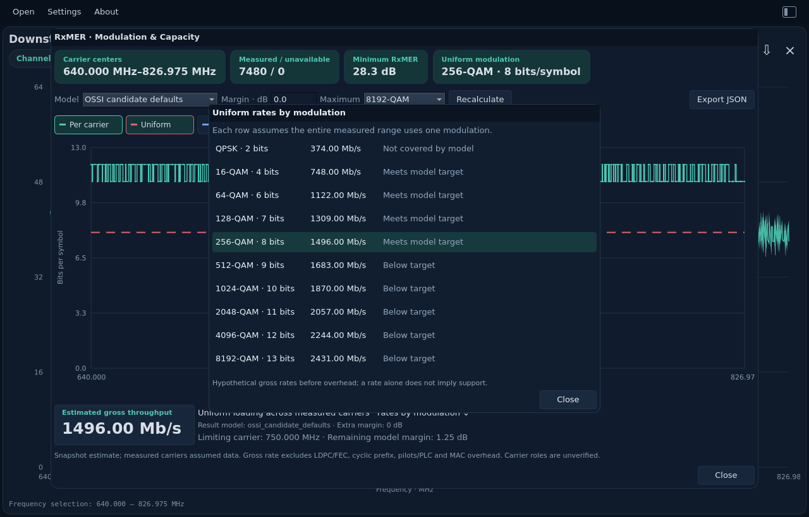
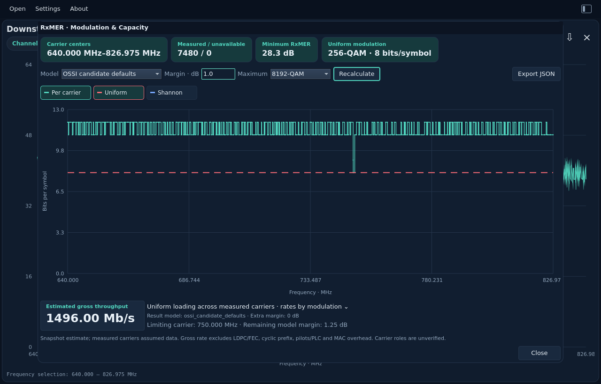
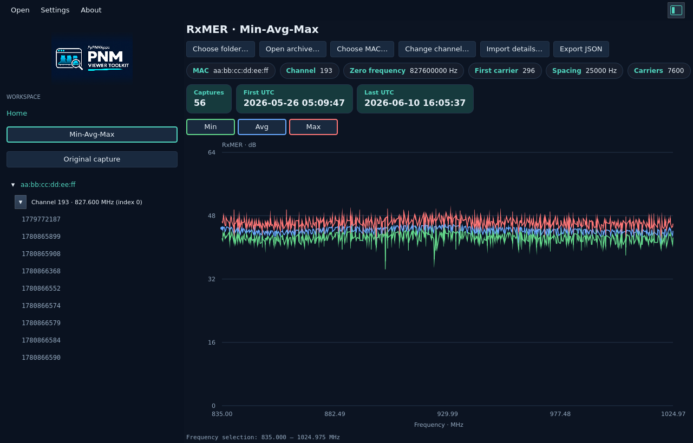

# RxMER

[All measurements](../../measurements.md) · [User guide](../../README.md) · [Project README](../../../../README.md)


RxMER in dB against frequency in MHz. Drag to investigate a frequency range; unavailable samples remain gaps.

Example: `rxmer.bin`.

<picture>
  <source media="(prefers-color-scheme: dark)" srcset="images/rxmer-dark.png">
  <source media="(prefers-color-scheme: light)" srcset="images/rxmer-light.png">
  
</picture>


## Modulation & Capacity

Zoom the RxMER chart to the frequency range you want, then right-click inside
it and select **Modulation & Capacity…**. With no zoom, the popup uses the whole capture.
It analyzes the original subcarriers, even when the main graph shows a sampled
overview. Closing it leaves your capture and zoom unchanged.

The popup uses the whole capture when opened before zooming; zooming is
optional. If the selected model cannot support one uniform order, the popup
still shows the per-carrier analysis and explains the limiting result.

The teal stepped line estimates each measured carrier's supported bits per
symbol. The red horizontal line shows the highest **single modulation** that
meets the selected model across all measured carriers in the range. The weakest
carrier limits that line; averaging the good carriers cannot hide a bad one.
Toggle **Shannon** to show the separate ideal upper bound in blue.

Choose a model, add a nonnegative margin in dB if needed, select a maximum QAM,
and press **Recalculate**. Its border turns teal when a setting differs from
the displayed result, and clears after the updated result arrives. Reverting
to the displayed settings also clears the highlight. The initial cap is 8192-QAM (13 bits/symbol), an
analysis choice rather than proof of modem capability. Results are estimates
from one capture, not a promise of error-free operation or a configured CMTS
profile. Missing readings remain gaps and the popup reports incomplete coverage.

| Model | What it means |
| --- | --- |
| WebUI heuristic | Same 256–4096-QAM MER targets as PyPNM-CMTS-WebUI selection insights |
| OSSI candidate defaults (default in viewer) | DOCSIS 3.1 CM-OSSI I27 D.2.11 candidate-profile default MER targets; actual configured targets may differ |
| Ideal Shannon | Ideal AWGN bound using MER as an SNR proxy; not a practical receiver threshold |

The large **Estimated gross throughput** chip assumes the measured carriers
carry data and use the uniform bit loading shown above:

`gross bit/s = measured carriers × uniform bits/symbol × subcarrier spacing (Hz)`

For example, 1,001 carriers at 10 bits/symbol and 25 kHz give **250.25 Mb/s**.
This excludes LDPC/BCH and other FEC redundancy, cyclic-prefix time, pilot/PLC
occupation, and MAC/other PHY overhead. It is not download or application speed.
RxMER alone does not identify every carrier's data/pilot role, so the assumption
stays visible. The range includes both carrier-center endpoints: 650–675 MHz at
25 kHz has 1,001 centers, not 1,000.

Click that chip to open **Uniform rates by modulation**. Each row assumes the
entire measured range uses that one modulation. A hypothetical rate can be
shown even when the model target is not met; the status column distinguishes
**Meets model target**, **Below target**, and **Not covered by model**. The large
chip uses the highest covered order meeting the model and cap, not the largest
hypothetical rate.

**Export JSON** saves the full-resolution popup result, its model/margin/cap,
coverage, per-carrier values and rate scenarios to a new file. This is separate
from the main capture's raw JSON export. The CLI can reproduce the same analysis;
see [CLI options](../../../cli/usage.md#rxmer-bit-loading-analysis).

The native screenshots below show the full 640–826.975 MHz capture using
OSSI candidate defaults: 7,480 measured carriers and a gross estimate of
1,496.00 Mb/s at 256-QAM.

<picture>
  <source media="(prefers-color-scheme: dark)" srcset="images/rxmer-bit-loading-dark.png">
  <source media="(prefers-color-scheme: light)" srcset="images/rxmer-bit-loading-light.png">
  
</picture>

<picture>
  <source media="(prefers-color-scheme: dark)" srcset="images/rxmer-uniform-rates-dark.png">
  <source media="(prefers-color-scheme: light)" srcset="images/rxmer-uniform-rates-light.png">
  
</picture>

### Why the whole capture can have no uniform result

The example capture has a weakest reading of 28.25 dB (shown as 28.3 dB) at
750 MHz. The optional WebUI heuristic only defines targets for 256–4096-QAM, starting
at 33 dB. For the complete capture it therefore reports **Below model minimum**
and an unavailable uniform throughput. That is a completed analysis, not a
file-loading failure. Zooming can exclude the weak carrier and change the result.

The viewer starts with **OSSI candidate defaults**. Choose that model and
**Recalculate** after switching models to evaluate the same
capture using its lower-QAM targets. This example then supports a uniform
256-QAM at the model's default 27 dB target: 7,480 measured carriers × 8 bits ×
25,000 Hz = **1,496 Mb/s** gross useful-symbol rate, before the stated overheads.
Do not interpret this as a configured modem profile or achievable payload speed.

The CLI retains its existing WebUI default. To reproduce the viewer’s initial
result, use `--rxmer-bit-loading --model ossi_candidate_defaults`. All
calculations and JSON fields still use the same shared Rust analysis.

### Changed settings

A teal **Recalculate** border means the controls differ from the graph's result.
For example, the margin below is now 1.0 dB while the result still records 0 dB.
Press **Recalculate** to update it. A failed calculation keeps the reminder.

<picture>
  <source media="(prefers-color-scheme: dark)" srcset="images/rxmer-recalculate-pending-dark.png">
  <source media="(prefers-color-scheme: light)" srcset="images/rxmer-recalculate-pending-light.png">
  
</picture>

## Min-Avg-Max

Show the left gutter and select **Min-Avg-Max**. Choose **Choose folder…** for
an entire capture directory (including subfolders), or **Open archive…** for
ZIP, TAR or TAR.GZ/TGZ. Compressed GZIP/Zstandard captures inside the import are
read automatically. Nothing is unpacked onto your filesystem.

1. Select a MAC address in the popup, displayed as `xx:xx:xx:xx:xx:xx`.
2. The first compatible channel opens automatically. Use **Change channel…**
   to choose another channel/grid. Compact chips show MAC, channel and grid
   metadata. Each channel and distinct frequency
   grid stays separate, even when it belongs to the same MAC.
3. View the **Min** (green), **Avg** (blue) and **Max** (red) lines. Matching button
   outlines identify each visible curve; click to show or hide it. Drag to zoom; double-click to reset.
4. Right-click the graph and select **Modulation & Capacity…**. The existing
   models and controls analyze the **average** over the visible frequency range,
   using full-resolution values rather than the displayed subset of points.
5. **Export JSON** saves the complete result, including source epochs, group
   metadata, all carrier statistics and per-carrier valid-reading counts.

MAC, channel, format, frequency grid and capture epoch come from parsed binary
headers. Filenames and filesystem modification times do not determine identity
or ordering. Byte-identical duplicates count once. Captures are ordered by
ascending encoded epoch, with source-name ordering for ties.

For each subcarrier, Min and Max are the lowest and highest valid RxMER readings
across the selected captures. Avg is their **arithmetic mean in dB**. Unavailable
readings do not contribute to the average; a carrier with no valid readings
stays a gap. A carrier with only one valid reading has equal Min/Avg/Max. This
is a temporal summary, separate from spectrum linear-power averaging.

The separation between Min and Max shows how much reception varied over the
capture period. A stable average with a low minimum can expose intermittent
impairments hidden by a single capture. Modulation estimates from Avg describe
the average line; they do not guarantee that every individual capture met that
modulation target. Use the Min curve to inspect the worst observed readings.

**Import details…** lists accepted, duplicate and skipped counts, with a bounded
list of skip reasons. Other PNM types are ignored. Import failures appear in a
file-error popup and preserve your previous results. **Cancel** stops a pending
import; selecting another channel replaces the graph once its calculation succeeds.
Returning to **Original capture** preserves the collection for later use.

Imports are bounded to 4096 visited entries, eight nesting levels, 64 MiB per
file/expanded member, 256 MiB total bytes read across expansion layers and four
million decoded samples. Symlinks and unsafe archive paths are skipped. Damaged,
encrypted or unsupported archive compression and exceeded limits report errors.

For the prepared local lab demo, open
`~/Downloads/demo-rxmer-min-avg-max/README.md`. Select its `captures` subfolder,
`captures.zip` or `captures.tar.gz`; use one input source at a time. Lab inputs
remain local and are not included in Git or release installers.

The screenshots show 56 lab captures from one channel in a five-channel
collection. The MAC is replaced by the repository's demonstration address
for documentation.

<picture>
  <source media="(prefers-color-scheme: dark)" srcset="images/rxmer-min-avg-max-dark.png">
  <source media="(prefers-color-scheme: light)" srcset="images/rxmer-min-avg-max-light.png">
  
</picture>

### Capture tree

The left gutter organizes imported files as:

```text
MAC address
  Channel ID · index-zero frequency in MHz
    epoch (oldest)
    epoch
    epoch (newest)
```

Expand the arrow beside a MAC to see its channels. Click a channel label to
show its Min-Avg-Max graph; expand its arrow to see capture epochs in ascending
order. Hover an epoch for its source path. Channels show the decoded
**subcarrier-zero frequency**, not the first active carrier's frequency.
The metadata chips preserve the separate first-active index.

All channel groups are retained; the tree has no five-channel limit. Distinct
formats or grids remain separate even if their MAC and channel IDs match.
Epoch ties remain separate captures with source-path ordering. The scrolling
tree creates controls only for visible rows, so hundreds of epochs stay browsable.

The larger local demo is
`~/Downloads/demo-rxmer-all-channels-over-time/captures.zip`: 279 unchanged
captures from one MAC across five channels. Its folder also contains `TREE.txt`
with the full hierarchy in epoch order.
