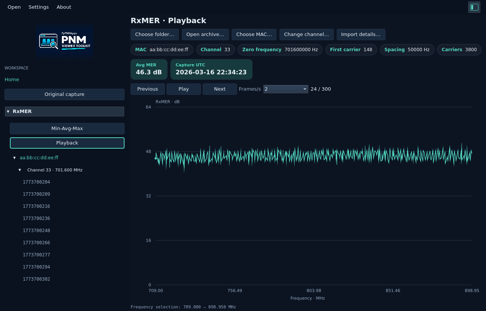

# RxMER Playback

Open the left gutter and choose **RxMER → Playback**. Use **Choose folder…** or
**Open archive…** to select a capture directory, ZIP, TAR or TAR.GZ, then select
its MAC address. The same imported collection can also be used in Min-Avg-Max.

The tree groups captures as **MAC → Channel · frequency in MHz → epoch**.
Channel frequency comes from the decoded subcarrier-zero field. Capture order
comes from the binary header timestamp, oldest first; filenames do not determine
it. Equal timestamps use source-path order. Different grids remain separate.

Click **Play** to replay the selected channel. **Pause**, **Previous** and **Next**
let you inspect individual captures. Choose 1, 2, 4 or 8 frames per second. This
sets the viewing speed; it does not reproduce elapsed time between captures.
The **Capture UTC** chip shows the capture's actual timestamp. **Avg MER** shows
the arithmetic mean in dB across all valid subcarriers in the displayed capture,
with one decimal place. It updates for each frame and stays unchanged when you
zoom. Unavailable readings are excluded; no valid readings shows a dash.

Expand a channel and click an epoch to jump directly to that capture. Selecting
an epoch or channel pauses playback. Playback also pauses at the last capture,
when you leave the workspace, open a dialog or switch to another window. Press
Play at the last capture to restart from the oldest one. A single capture can
be viewed but has no Play action.

Drag across the plot to zoom; the same carrier range stays selected as captures
advance. Double-click to restore the full channel. The frequency grid and 0–64 dB
axis stay fixed, making changes easier to spot. Unavailable carriers remain gaps.
Right-click **Modulation & Capacity** to analyze the displayed capture over the
current range. It uses the original full-resolution values in Rust, independently
of chart decimation. Opening the analysis pauses playback.

Playback helps locate when a notch or other impairment appeared, disappeared
or moved. Use [Min-Avg-Max](README.md#min-avg-max) for the whole-period summary,
then Playback to inspect the captures behind that variation. The playback graph
shows one measured capture at a time; it does not interpolate new measurements.

<picture>
  <source media="(prefers-color-scheme: dark)" srcset="images/rxmer-playback-dark.png">
  <source media="(prefers-color-scheme: light)" srcset="images/rxmer-playback-light.png">
  
</picture>

## Local demo

Open `~/Downloads/demo-rxmer-tftp-backup/channel-35-983-captures.zip` for 983
captures from one MAC/channel, or `multi-channel-900-captures.zip` for 300 captures
on each of three channels. These private lab datasets are local only; see their
folder README for provenance and import limits. The documentation screenshots
use a copy with the demonstration MAC address substituted.

The [collection limits and import details](README.md#min-avg-max) also apply to
Playback. Import errors appear in a popup and preserve the previous collection.

## Decoding

Files are decoded once during import through the shared Rust PNM parser library,
the same decoding implementation used by `pnm-decode`. The viewer does not launch
a CLI subprocess for each file. Playback reuses the decoded samples held in Rust.
