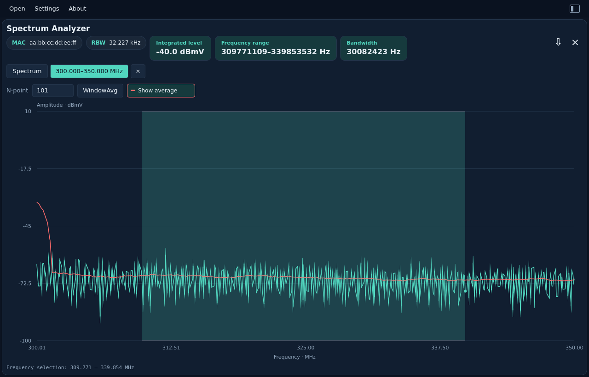
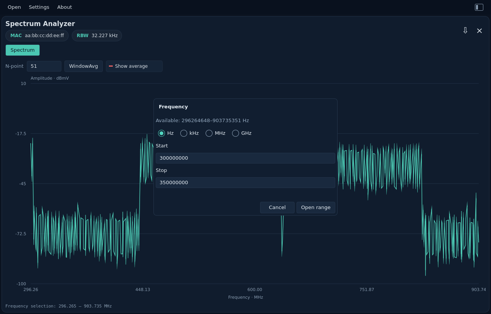

# Spectrum Analyzer

[All measurements](../../measurements.md) · [User guide](../../README.md) · [Project README](../../../../README.md)

Amplitude in dBmV against frequency in MHz. The RBW chip shows resolution
bandwidth calculated in Rust from the capture fields.

Enter a positive whole number in **N-point**, then press **WindowAvg** to add a
red averaged trace. **Show average** becomes enabled after calculation; press it
to hide or restore that line. Press WindowAvg again to apply a different N.
The default input is 101; allowed input is 1–2,147,483,647. N=1 reproduces the
original levels. The original trace remains teal.

Rust averages linear power: `10 × log10(mean(10^(dBmV / 10)))`. The window is
centered, with reflected samples at the capture ends. Even windows have one
more sample on the lower-frequency side. Windows can exceed the capture length.
Zoom uses the full-resolution source bins, so the same frequency has the same
average before and after zoom. This is smoothing across frequency; it does not
change acquisition RBW or calculate integrated channel power. JSON exports
contain the full original capture.

Right-click the spectrum for:

- **Calculate power…**: drag across the graph to highlight a band and calculate
  its integrated level in **dBmV**, shown to one decimal place. Larger labeled
  chips beside MAC and RBW show the integrated level, frequency range and
  bandwidth. They wrap onto another row when the window is narrow. Press Escape to cancel selection or clear its highlight.
  The calculation uses original bins and acquisition ENBW, even when an averaged
  trace is visible. It sums mean-square voltage; it does not average dB values.
- **Frequency…**: enter Start and Stop, select **Hz**, **kHz**, **MHz** or **GHz**,
  then press **Open range**. Invalid, reversed, out-of-capture or too-narrow graph
  ranges disable submission. The available capture bounds are shown in Hz.
  A range needs at least two original bin centers to create its graph.

The new range appears in a separate tab. Each tab has the same WindowAvg controls,
its own zoom, and its own averaging settings. Double-click resets to that tab's
range. Close a range with its **×**; the original Spectrum tab stays available.
Up to 16 tabs can be open, including the original. All share the same capture.
Opening another capture clears the tabs. Selection results are transient and do
not change the full original capture exported as JSON.

See [integration math and Rust architecture](../../../development/spectrum-power.md)
for the dBmV equation, ENBW correction and numerical assumptions.

Example: `spectrum_analyzer.bin`.

<picture>
  <source media="(prefers-color-scheme: dark)" srcset="images/spectrum-dark.png">
  <source media="(prefers-color-scheme: light)" srcset="images/spectrum-light.png">
  
</picture>

Frequency range dialog

<picture>
  <source media="(prefers-color-scheme: dark)" srcset="images/spectrum-frequency-dark.png">
  <source media="(prefers-color-scheme: light)" srcset="images/spectrum-frequency-light.png">
  
</picture>

