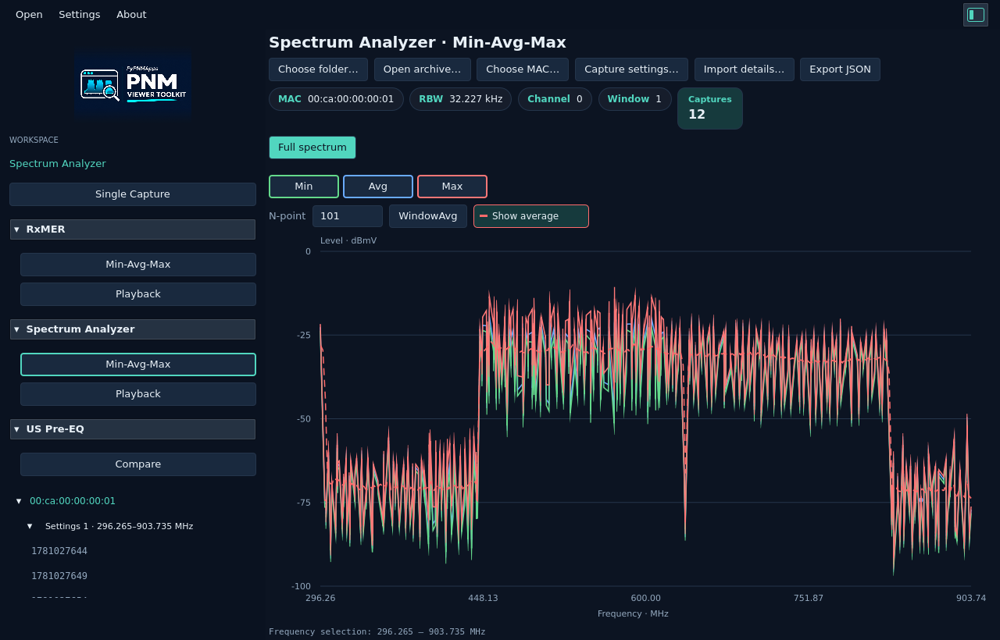
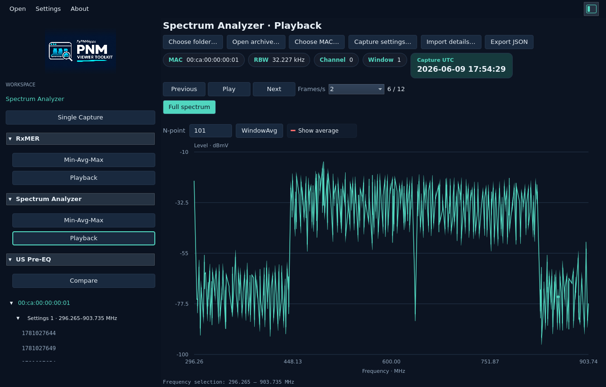

# Spectrum Min-Avg-Max and Playback

[Spectrum Analyzer](README.md) · [User guide](../../README.md) · [Examples](../../examples.md)

Open **Spectrum Analyzer → Min-Avg-Max** or **Playback** in the left navigation
pane. Choose a folder or ZIP/TAR/TAR.GZ archive, or drop one into that workspace.
Only standard PNM spectrum captures are included. Select a MAC address when asked.

The tree is **MAC address → Capture settings → Epoch time**, oldest first.
Each settings node groups captures with identical acquisition metadata: channel,
file-format version, segment centers/span, bin count/spacing, ENBW/RBW and window
function. Different settings have separate nodes even when frequency ranges look
similar. **Capture settings…** shows the full settings labels. Filenames do not
determine grouping or time. **Import details…** lists accepted/duplicate/skipped
files. File errors appear in a popup; failed imports retain the previous result.

## Min-Avg-Max

The three curves show each source frequency bin across compatible captures:

- **Min — green:** lowest recorded level.
- **Avg — blue:** equal-capture-weight linear-power average, converted to dBmV.
- **Max — red:** highest recorded level.

Use the matching outlined buttons to hide/show a curve. A wide min-to-max spread
helps reveal changing levels or intermittent peaks that a single capture can miss.
One capture produces coincident curves. Drag to zoom; double-click to reset.
**Export JSON** retains all bins, source times, acquisition settings and valid counts.

**WindowAvg** smooths neighboring frequencies on the temporal-average trace. Its
red dashed line distinguishes it from the solid red maximum. **Show average**
hides/restores the smoothing line. This does not change temporal statistics or RBW.

Right-click **Calculate power…**, then drag a band, to integrate the full-resolution
Avg trace. **Frequency…** opens a validated range in its own tab. Each tab retains
its zoom and WindowAvg settings. The source acquisition RBW is used for power;
plot decimation and smoothing do not replace the underlying bins.

<picture>
  <source media="(prefers-color-scheme: dark)" srcset="images/spectrum-collection-dark.png">
  <source media="(prefers-color-scheme: light)" srcset="images/spectrum-collection-light.png">
  
</picture>

## Playback

Select the acquisition settings and press **Play**. Frames follow the binary-header
epoch order. Use Pause, Previous, Next or an epoch tree entry; choose the display
rate with **Frames/s**. The selected capture's UTC time and frame count are shown.
Playback stops when hidden, at the last frame or while a dialog/operation is active.

Frequency selection, mouse zoom and WindowAvg remain available. Ranges/settings
stay selected across compatible frames. Power uses the current original capture;
Export JSON exports that frame's full-resolution data.

<picture>
  <source media="(prefers-color-scheme: dark)" srcset="images/spectrum-playback-dark.png">
  <source media="(prefers-color-scheme: light)" srcset="images/spectrum-playback-light.png">
  
</picture>

## Demo

The bundled `spectrum/synthetic-time-series.zip` contains 12 standard-format
frames with identical acquisition settings. Times and levels, including a moving
peak, are explicitly **synthetic**. This demonstrates the controls; it is not a
real repeated modem measurement. Sources and provenance are under
[tests/fixtures/demos/spectrum-synthetic](../../../../tests/fixtures/demos/spectrum-synthetic/README.md).

For a local source checkout, generate an examples bundle with
`python3 scripts/release/samples.py --output local/examples-review` and select
`local/examples-review/spectrum/synthetic-time-series.zip`.

See [temporal math and JSON](../../../reference/spectrum-collections.md).
