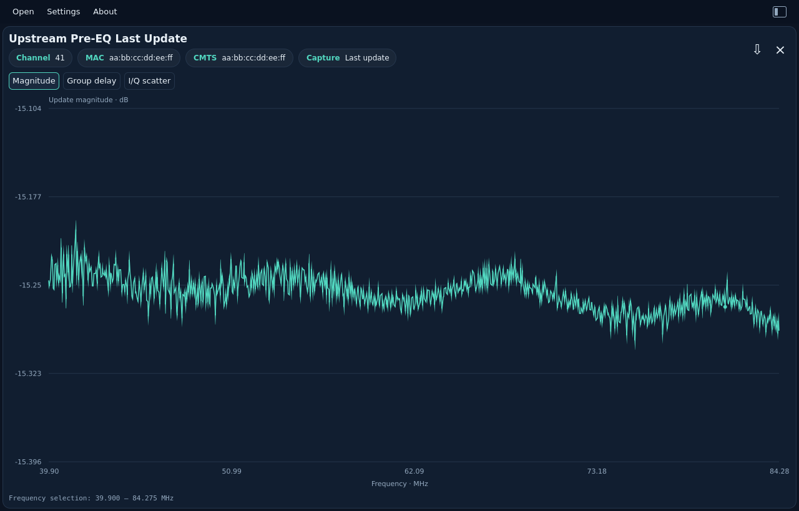
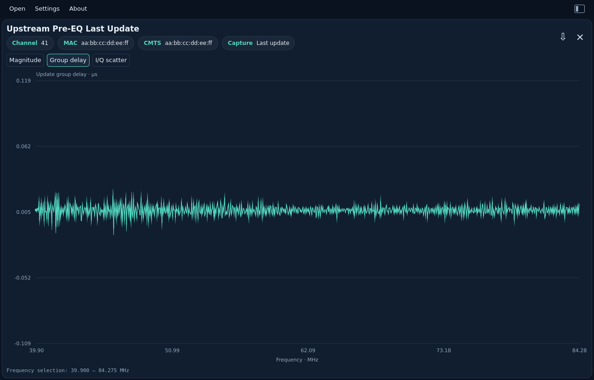
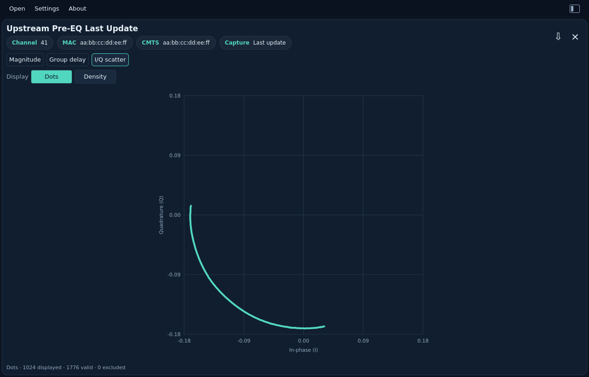
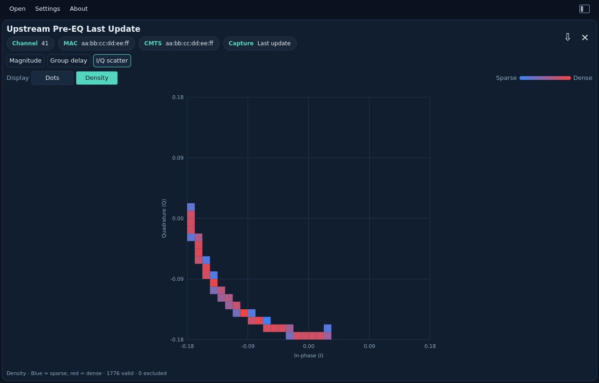

# US Pre-EQ (last update)

[All measurements](../../measurements.md) · [User guide](../../README.md) · [Project README](../../../../README.md)

Open or drop `us_pre_equalizer_coef_last.bin` (PNN7). **Upstream Pre-EQ Last
Update** and the **Last update** chip distinguish this file from the current
coefficient set. Channel, CM MAC and CMTS MAC retain the same meanings.

This capture contains the complex coefficients sent in the last RNG-RSP that
contained a pre-EQ update, encoded in **s1.14**. It is a separate measurement
from the current s2.13 coefficient set. The file does not encode whether those
updates were applied, clipped or rejected; the viewer does not infer that status.
OSSI describes these CMTS equalizer updates as representing the residual channel
after pre-equalization. The charts show the captured update coefficients
as supplied, without combining them with a current capture or inverting them
into a measured plant response.

Choose **Magnitude**, **Group delay**, or **I/Q scatter**. Update magnitude is
in dB relative to unit amplitude. Update group delay is derived from unwrapped
coefficient phase and shown in µs; it is not absolute cable propagation delay.
The same drag/wheel zoom and double-click reset work on both frequency plots.
I/Q scatter offers **Dots** and **Density**, always covering the full capture.
Dots shows up to 1,024 original pairs; Density uses blue for sparse cells and red
for dense cells. See [why use this view](../channel-estimation/README.md#why-use-this-view). Switching tabs resets the range.
All calculations, decimation and density aggregation run in shared Rust code.
Zero coefficients remain in raw I/Q and appear as gaps for undefined magnitude
and delay. Signed minimum pairs are valid coefficients.

Export and CLI now both include full-resolution `pre_equalization_analysis`
for last-update files, with `frequencies_hz`, `magnitude_db` and `group_delay`
pairs in seconds. Original metadata and s1.14 I/Q remain unchanged. Zoom never
reduces exported data. See the [JSON contract](../../../reference/formats.md#upstream-pre-equalization-analysis)
and [complete last-update example](../../../cli/examples/upstream-pre-eq-last.json).

**Magnitude**

<picture>
  <source media="(prefers-color-scheme: dark)" srcset="images/upstream-pre-eq-last-dark.png">
  <source media="(prefers-color-scheme: light)" srcset="images/upstream-pre-eq-last-light.png">
  
</picture>

**Group delay**

<picture>
  <source media="(prefers-color-scheme: dark)" srcset="images/upstream-pre-eq-last-delay-dark.png">
  <source media="(prefers-color-scheme: light)" srcset="images/upstream-pre-eq-last-delay-light.png">
  
</picture>

**I/Q scatter**

**Dots**

<picture>
  <source media="(prefers-color-scheme: dark)" srcset="images/upstream-pre-eq-last-iq-dots-dark.png">
  <source media="(prefers-color-scheme: light)" srcset="images/upstream-pre-eq-last-iq-dots-light.png">
  
</picture>

**Density**

<picture>
  <source media="(prefers-color-scheme: dark)" srcset="images/upstream-pre-eq-last-iq-dark.png">
  <source media="(prefers-color-scheme: light)" srcset="images/upstream-pre-eq-last-iq-light.png">
  
</picture>

To attach this file as a correction to an older compatible current capture,
use [Correction & Delta in the left gutter](../upstream-pre-eq/README.md#correction--delta-from-the-left-gutter).
The two file timestamps must meet the viewer’s strict newer-only policy.
