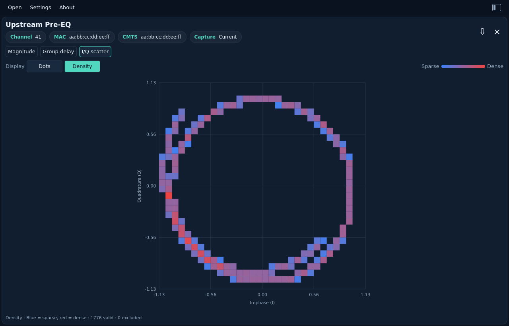
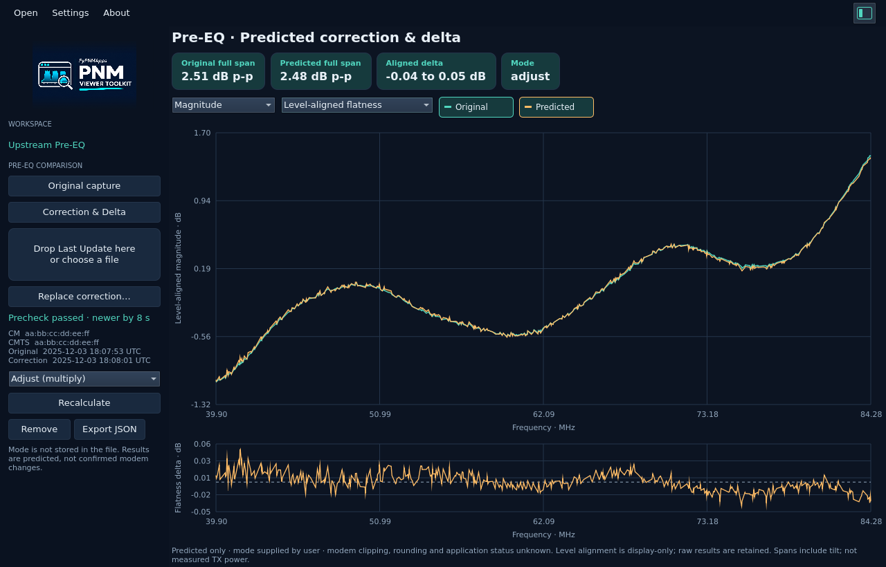
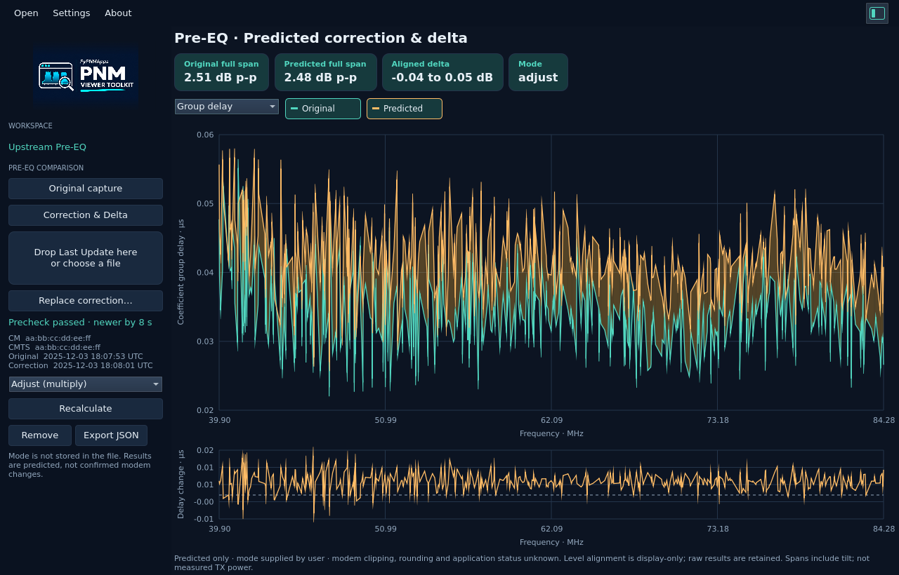
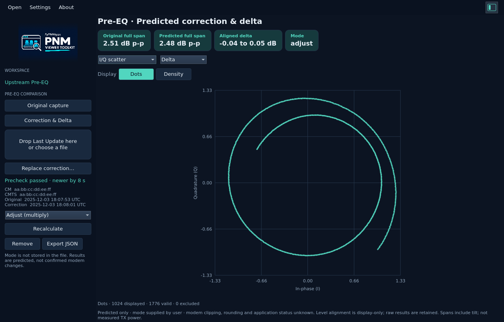

# US Pre-EQ (current)

[All measurements](../../measurements.md) · [User guide](../../README.md) · [Project README](../../../../README.md)

Open or drop `us_pre_equalizer_coef.bin` (PNN6). The first upstream view uses the
current CM coefficients in s2.13 format. Channel, CM MAC and CMTS address chips
identify the capture. The CMTS field is the downstream channel MAC used for
MAPs/UCDs, as defined by OSSI. The **Current** chip distinguishes this capture
from the [last-update format](../upstream-pre-eq-last/README.md), which has its own view.

Choose **Magnitude**, **Group delay**, or **I/Q scatter**. The layout follows
[PyPNM's single-capture pre-equalization view](https://github.com/PyPNMApps/PyPNM-CMTS-WebUI/blob/25f40bda432f3c72df1e606bb229ffc5ba4eacf8/src/pw/features/operations/SingleUsOfdmaPreEqualizationView.tsx),
with compact metadata and frequency-domain inspection:

- Magnitude is `20 log10(|I + jQ|)` in dB relative to unit amplitude. No extra
  normalization or smoothing is applied.
- Group delay is derived from the unwrapped coefficient phase and shown in µs.
  It describes the correction response, not measured cable propagation delay.
  Phase steps beyond π are ambiguous; no absolute delay is recovered.
- I/Q scatter offers **Dots** and **Density** on equal axes. Dots shows up to
  1,024 original pairs; Density counts every valid pair, blue for sparse areas
  and red for dense clusters. See [why use this view](../channel-estimation/README.md#why-use-this-view).
  This overview has no range zoom.

Drag to zoom a frequency range, use the mouse wheel around the pointer, and
double-click to reset. Switching tabs resets the range. Rust computes all
analysis and bounds the display to 1,024 points/cells while keeping full-resolution
exports. Zero coefficients stay in raw I/Q; undefined magnitude and delay become
null/gaps. Signed minimum coefficients are valid upstream samples, not the
excluded-carrier marker used by downstream channel estimates.

These are **pre-equalizer correction coefficients**, not a direct measured
channel response. This first view does not invert them into an estimated plant
response or infer echo distance. Current (PNN6) and last-update (PNN7) files are
separate measurements with different Q-formats; the viewer does not combine them.

Export JSON and `pnm-decode` share the same `pre_equalization_analysis` object,
including full-resolution frequencies, magnitude and frequency/delay pairs in
seconds. Original header, CMTS MAC and every I/Q sample are retained. See the
[JSON contract](../../../reference/formats.md#upstream-pre-equalization-analysis)
and [complete CLI example](../../../cli/examples/upstream-pre-eq.json).

**Magnitude**

<picture>
  <source media="(prefers-color-scheme: dark)" srcset="images/upstream-pre-eq-dark.png">
  <source media="(prefers-color-scheme: light)" srcset="images/upstream-pre-eq-light.png">
  
</picture>

**Group delay**

<picture>
  <source media="(prefers-color-scheme: dark)" srcset="images/upstream-pre-eq-delay-dark.png">
  <source media="(prefers-color-scheme: light)" srcset="images/upstream-pre-eq-delay-light.png">
  
</picture>

**I/Q scatter**

**Dots**

<picture>
  <source media="(prefers-color-scheme: dark)" srcset="images/upstream-pre-eq-iq-dots-dark.png">
  <source media="(prefers-color-scheme: light)" srcset="images/upstream-pre-eq-iq-dots-light.png">
  
</picture>

**Density**

<picture>
  <source media="(prefers-color-scheme: dark)" srcset="images/upstream-pre-eq-iq-dark.png">
  <source media="(prefers-color-scheme: light)" srcset="images/upstream-pre-eq-iq-light.png">
  
</picture>

## Correction & Delta from the left gutter

For a ready-to-open pair and walkthrough, use the
[sanitized comparison demo](../../../../tests/fixtures/demos/us-pre-eq-comparison/README.md).
It contains the two files used for the screenshots below.

Open a **current US Pre-EQ** capture, show the left navigation with the panel
button, and select **Compare**. This section is available for current
PNN6 captures; opening a Last Update file by itself keeps its existing view.
The **Compare** tool opens its attachment and calculation controls. Choose
**Original capture** to return to the measurement and hide those controls; the
attached pair and completed comparison are retained.

1. Drop one Last Update file onto **Drop Last Update here**, or choose it with
   **Choose Last Update…** using the OS file picker. Dropping there attaches it;
   dropping elsewhere keeps the usual behavior of opening a new capture.
2. Wait for the mode selector to become available. Rust requires a PNN7 correction and checks the
   format version, channel, **CM MAC and CMTS MAC**, zero frequency, first-active
   index, spacing, data length, and coefficient count. Grids must match exactly.
3. The correction's encoded capture timestamp must be strictly newer. Equal or
   earlier timestamps fail, even if filenames suggest otherwise. Header details
   remain in exported JSON rather than occupying the gutter.
4. Select **Adjust (multiply)** or **Set (replace)**, then **Compare**. The PNM
   file does not encode that mode; select it from known capture context.
5. The main workspace shows original (teal) and predicted (amber) curves, with
   shading between them and a separate delta plot. Toggle either trace, choose
   Magnitude or Group delay, and drag to zoom; double-click to reset. I/Q scatter
   offers Original, Predicted or complex Delta, each with Dots/Density.

For Adjust, the predicted coefficient is `original × correction` using complex
I/Q multiplication. Set replaces it with the correction. Complex delta is
`predicted − original`. Delta magnitude is the difference between the original
and predicted dB magnitudes, **not** the logarithm of the complex delta.

**Level-aligned flatness** references each curve to its own mean coefficient
power across all matched carriers, making small shape changes visible separately
from common gain. **Raw coefficient magnitude** preserves the original gain
references. Alignment is a labeled display operation, not simulated modem
normalization or measured TX power. The full-span chips include tilt and refer
to the full paired capture, even while the graphs are zoomed.

A changed update mode highlights the **Recalculate** border until the matching
result succeeds. **Original capture** returns to the untouched capture/zoom.
**Remove** discards the attachment/results. Failed replacements preserve the
previous valid pair. A **File error** popup explains the rejected candidate;
choose **OK** to dismiss it. Open and export failures also show this popup.

**Export JSON** saves the full result, including both headers and MAC addresses,
explicit mode, raw predicted/delta I/Q, raw/aligned dB, group delay in seconds,
precheck metadata and assumptions. Zoom does not reduce the export. Existing
outputs are never overwritten. See [CLI pairing options](../../../cli/usage.md#pre-eq-precheck-and-correction-comparison)
and the [synthetic JSON example](../../../cli/examples/pre-eq-comparison-synthetic.json).

These are **predicted coefficient changes**. A newer file timestamp cannot prove
that the correction is the next update after the baseline. Clipping, rejection,
rounding, reset history and actual application status are unavailable in these
files. Shaded dB separation is not absolute RF power or measured plant flatness.

Specification references: CM-SP-CM-OSSIv3.1-I27-250219 D.2.13, Tables77/78;
CM-SP-CM-OSSIv4.0-I13-260429 D.2.13, Tables110/111; and
CM-SP-PHYv3.1-I20-230419 §7.4.17 for Adjust versus Set behavior.

These screenshots use sanitized repository fixtures and a **synthetic correction
timestamp eight seconds later** to demonstrate the UI. They do not establish
a real update sequence or known modem application mode.

<picture>
  <source media="(prefers-color-scheme: dark)" srcset="images/pre-eq-comparison-dark.png">
  <source media="(prefers-color-scheme: light)" srcset="images/pre-eq-comparison-light.png">
  
</picture>

<picture>
  <source media="(prefers-color-scheme: dark)" srcset="images/pre-eq-comparison-delay-dark.png">
  <source media="(prefers-color-scheme: light)" srcset="images/pre-eq-comparison-delay-light.png">
  
</picture>

<picture>
  <source media="(prefers-color-scheme: dark)" srcset="images/pre-eq-comparison-iq-dark.png">
  <source media="(prefers-color-scheme: light)" srcset="images/pre-eq-comparison-iq-light.png">
  
</picture>
