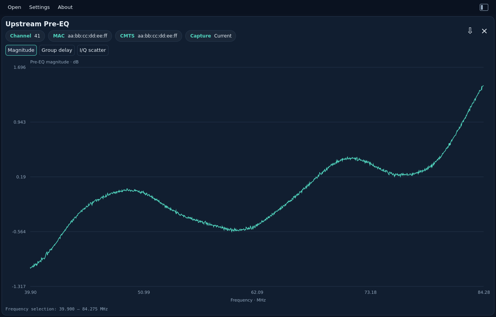
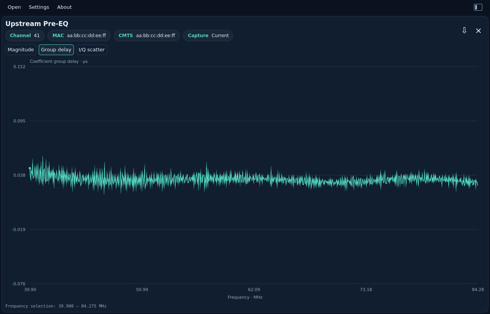
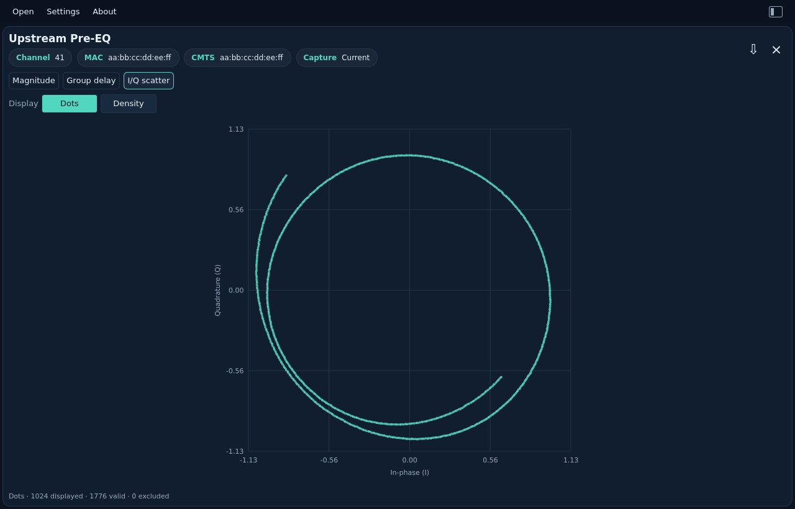

# US Pre-EQ (current)

[All measurements](../../measurements.md) · [User guide](../../README.md) · [Project README](../../../../README.md)

Open or drop `us_pre_equalizer_coef.bin` (PNN6). The first upstream view uses the
current CM coefficients in s2.13 format. Channel, CM MAC and CMTS address chips
identify the capture. The CMTS field is the downstream channel MAC used for
MAPs/UCDs, as defined by OSSI. The **Current** chip distinguishes this capture
from the [last-update format](../upstream-pre-eq-last/README.md), which has its own view.

Choose **Magnitude**, **Group delay**, or **I/Q scatter**. The layout follows
[PyPNM's single-capture pre-equalization view](https://github.com/PyPNMApps/PyPNM-CMTS-WebUI/blob/25f40bda432f3c72df1e606bb229ffc5ba4eacf8/src/pw/features/operations/SingleUsOfdmaPreEqualizationView.tsx),
with compact metadata and frequency-domain inspection:

- Magnitude is `20 log10(|I + jQ|)` in dB relative to unit amplitude. No extra
  normalization or smoothing is applied.
- Group delay is derived from the unwrapped coefficient phase and shown in µs.
  It describes the correction response, not measured cable propagation delay.
  Phase steps beyond π are ambiguous; no absolute delay is recovered.
- I/Q scatter offers **Dots** and **Density** on equal axes. Dots shows up to
  1,024 original pairs; Density counts every valid pair, blue for sparse areas
  and red for dense clusters. See [why use this view](../channel-estimation/README.md#why-use-this-view).
  This overview has no range zoom.

Drag to zoom a frequency range, use the mouse wheel around the pointer, and
double-click to reset. Switching tabs resets the range. Rust computes all
analysis and bounds the display to 1,024 points/cells while keeping full-resolution
exports. Zero coefficients stay in raw I/Q; undefined magnitude and delay become
null/gaps. Signed minimum coefficients are valid upstream samples, not the
excluded-carrier marker used by downstream channel estimates.

These are **pre-equalizer correction coefficients**, not a direct measured
channel response. This first view does not invert them into an estimated plant
response or infer echo distance. Current (PNN6) and last-update (PNN7) files are
separate measurements with different Q-formats; the viewer does not combine them.

Export JSON and `pnm-decode` share the same `pre_equalization_analysis` object,
including full-resolution frequencies, magnitude and frequency/delay pairs in
seconds. Original header, CMTS MAC and every I/Q sample are retained. See the
[JSON contract](../../../reference/formats.md#upstream-pre-equalization-analysis)
and [complete CLI example](../../../cli/examples/upstream-pre-eq.json).

**Magnitude**

<picture>
  <source media="(prefers-color-scheme: dark)" srcset="images/upstream-pre-eq-dark.png">
  <source media="(prefers-color-scheme: light)" srcset="images/upstream-pre-eq-light.png">
  
</picture>

**Group delay**

<picture>
  <source media="(prefers-color-scheme: dark)" srcset="images/upstream-pre-eq-delay-dark.png">
  <source media="(prefers-color-scheme: light)" srcset="images/upstream-pre-eq-delay-light.png">
  
</picture>

**I/Q scatter**

**Dots**

<picture>
  <source media="(prefers-color-scheme: dark)" srcset="images/upstream-pre-eq-iq-dots-dark.png">
  <source media="(prefers-color-scheme: light)" srcset="images/upstream-pre-eq-iq-dots-light.png">
  
</picture>

**Density**

<picture>
  <source media="(prefers-color-scheme: dark)" srcset="images/upstream-pre-eq-iq-dark.png">
  <source media="(prefers-color-scheme: light)" srcset="images/upstream-pre-eq-iq-light.png">
  
</picture>

