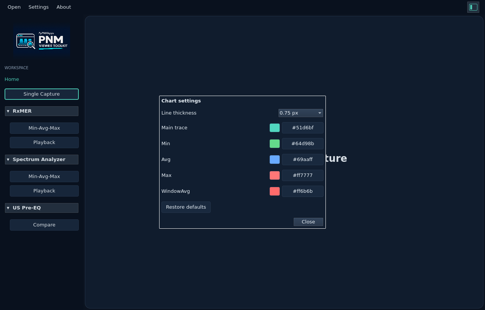

# Chart settings

[User guide](README.md) · [Measurement gallery](measurements.md)

Open **Settings → Charts…** to change the style of line charts throughout the
viewer. Changes apply immediately to open captures, collection plots and
comparison views. These preferences apply to the current application session,
matching the existing System/Dark/Light preference.

- **Line thickness:** choose 0.25–4 px. The default is **0.75 px**.
- **Main trace:** the default is the current theme's teal.
- **Min / Avg / Max:** defaults are green / blue / red, with the existing dark
  and light palettes. Changes also update their curve-toggle outlines.
- **WindowAvg:** the default remains red.

Click a color value beside its swatch to open the color picker. Custom colors
apply in both themes. **Restore defaults** restores 0.75 px and the theme-aware
colors. Chart styling does not change decoded data, analysis or exported JSON.

The global thickness applies to measurement traces, modulation profiles, RxMER
capacity, FEC and pre-EQ line plots. Individual profile, carrier and FEC-series
colors retain their measurement legends; the Main trace control sets the common
single-trace color.

<picture>
  <source media="(prefers-color-scheme: dark)" srcset="images/settings/chart-settings-dark.png">
  <source media="(prefers-color-scheme: light)" srcset="images/settings/chart-settings-light.png">
  
</picture>
